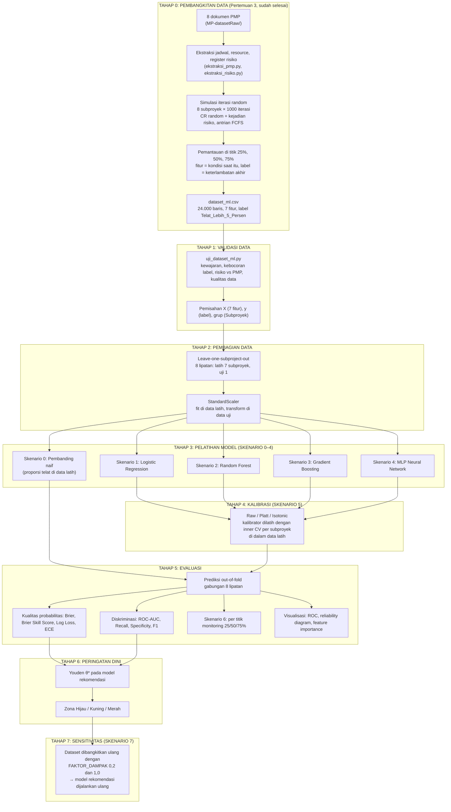

# DOKUMEN IMPLEMENTASI DESAIN EKSPERIMEN (PERTEMUAN 4) — VERSI 2
## Topik Riset: PRE-02 — Prediksi Probabilitas Keterlambatan Proyek Multi Sumber Daya Terbatas
**Studi Kasus:** Portofolio Modul Super ERP Farm Nation Enterprise (FNE) 2026
**Penanggung Jawab:** Lead Author & Tim Peneliti PRE-02
**Versi:** 2 (November 2026), menggantikan versi September 2026 (tersimpan di riwayat git)

---

## 1. Ringkasan

Dokumen ini adalah rancangan ulang desain eksperimen setelah bimbingan 7 Oktober 2026. Dosen mengarahkan agar
data berasal dari jadwal dan sumber daya di PMP, dengan *change request* (CR) yang disimulasikan memakai bilangan
random dan diulang berkali-kali. Metode utama penelitian tetap mengikuti `Deskripsi_Penelitian.md`: empat model
*machine learning* probabilistik, analisis kalibrasi, dan ambang peringatan dini.

Capaian Pertemuan 4 menurut `progres_penelitian_MP.md`:

| Materi / luaran Pertemuan 4 | Dipenuhi oleh |
| :--- | :--- |
| Implementasi metode sesuai instruksi | 4 model + kalibrasi sesuai `Deskripsi_Penelitian.md` §3–§4 (Bagian 4) |
| Penyusunan skenario eksperimen | Skenario 0–7 (Bagian 4) |
| Penentuan parameter & variabel kontrol | Bagian 3, 5, dan 6 |
| Flow eksperimen | Bagian 2 |
| Script/tools eksperimen | `experiment_pipeline.py` versi 2 (Bagian 9) |
| Draf metodologi (bagian eksperimen) | Disusun dari dokumen ini setelah hasil eksperimen keluar |

### 1.1. Perubahan dari versi 1

| Aspek | Versi 1 (September 2026) | Versi 2 (dokumen ini) | Alasan |
| :--- | :--- | :--- | :--- |
| Sumber data | `dataset_pre02_fne_v3.csv`, 26 modul; SPI, utilisasi, dan jumlah CR hasil estimasi tim | `06_simulasi_iterasi/dataset_ml/dataset_ml.csv`, 24.000 baris dari simulasi jadwal & risiko PMP | Revisi dosen 7 Okt: data harus dari PMP dan CR disimulasikan; label versi 1 diturunkan dari SPI yang diestimasi |
| Satuan data | 1 baris = 1 modul | 1 baris = 1 proyek simulasi pada 1 titik monitoring | Sesuai Deskripsi Penelitian: prediksi dari "kondisi aktual pada tahap monitoring" |
| Variabel bebas | 7 variabel perencanaan + monitoring | 7 variabel monitoring persis seperti Deskripsi Penelitian §2 | Kesesuaian dengan desain yang diberikan |
| Label | `Status_Delay` (SPI ≤ 0,90) | `Telat_Lebih_5_Persen` (PMP-01 §4.7.3) | Label dihitung, bukan ditetapkan |
| Validasi | Stratified 5-fold + hold-out 80:20 | *Leave-one-subproject-out* (8 lipatan) | Baris dari subproyek yang sama sangat mirip; model harus diuji pada subproyek yang belum pernah dilihat |
| Implementasi model | Ditulis ulang dengan numpy | scikit-learn, hyperparameter sama | Uji waktu: model numpy butuh ±3 jam (RF) dan ±7 jam (GB) per eksperimen pada data baru (Bagian 9.1) |
| Skenario | 5 skenario | 5 skenario inti + pembanding naif + analisis per titik monitoring + analisis sensitivitas | Kebutuhan baru dari data simulasi |

---

## 2. Flowchart Alur Eksperimen

---

## 3. Data dan Variabel

### 3.1. Sumber data

| Hal | Isi |
| :--- | :--- |
| Berkas | `06_simulasi_iterasi/dataset_ml/dataset_ml.csv` |
| Ukuran | 24.000 baris = 8 subproyek × 1000 iterasi × 3 titik monitoring |
| Pembangkit | `06_simulasi_iterasi/buat_dataset_ml.py` (seed `42-ml-<kode>`, hasil identik setiap dijalankan) |
| Dokumentasi | `06_simulasi_iterasi/dataset_ml/README.md` (kamus variabel, rujukan parameter, karakteristik, validasi) |
| Parameter simulasi | Peluang & dampak risiko dari register PMP dengan skala PMP-01 §9.3.1; faktor mitigasi 0,4 dikalibrasi ke PMP-08 §9.6.2; CR dari contoh dosen |

### 3.2. Variabel penelitian

| Simbol | Kolom | Variabel Deskripsi Penelitian §2 | Tipe | Definisi operasional |
| :---: | :--- | :--- | :---: | :--- |
| $X_1$ | `SPI_Jadwal` | Progres aktual dibanding rencana | Rasio | EV/PV dengan nilai pekerjaan = durasi rencana |
| $X_2$ | `Sisa_Waktu_Hari` | Sisa waktu hingga deadline | Numerik | Hari selesai rencana − hari monitoring |
| $X_3$ | `Backlog_Sisa_Persen` | Backlog yang tersisa | Rasio 0–1 | 1 − EV / total durasi rencana |
| $X_4$ | `Utilisasi_Resource` | Tingkat utilisasi sumber daya | Rasio 0–1 | Hari-orang terpakai ÷ hari-orang tersedia sampai hari monitoring |
| $X_5$ | `Risiko_Belum_Dimitigasi` | Jumlah risiko yang belum dimitigasi | Diskrit | Kejadian risiko yang aktivitas terdampaknya belum selesai |
| $X_6$ | `Frekuensi_CR` | Frekuensi perubahan | Diskrit | Jumlah CR pada aktivitas yang sudah dimulai |
| $X_7$ | `Pergeseran_Dependency_Hari` | Kinerja dependency | Numerik | Rata-rata pergeseran hari siap (menunggu predecessor) vs rencana |
| $Y$ | `Telat_Lebih_5_Persen` | Probabilitas keterlambatan (target) | Biner | 1 jika keterlambatan akhir > 5% durasi rencana (PMP-01 §4.7.3) |
| $G$ | `Subproyek` | – | Kategori | Kelompok untuk pembagian data; **bukan** fitur |

`Titik_Monitoring`, `Hari_Monitoring`, `Iterasi`, dan label lain (`Telat`, `Telat_Lebih_10_Persen`,
`Keterlambatan_Akhir_Hari`) **tidak** dipakai sebagai fitur. `Titik_Monitoring` dipakai untuk analisis per titik
(Skenario 6). Satu model dilatih untuk semua titik monitoring.

### 3.3. Karakteristik yang memengaruhi desain

| Karakteristik | Dampak pada desain |
| :--- | :--- |
| Label 44,8% positif secara total, tetapi P-FNE-02 0,4% dan P-FNE-04 98,9% | Metrik dihitung dari prediksi gabungan semua lipatan; AUC per lipatan tidak terdefinisi untuk subproyek yang hampir satu kelas |
| `Sisa_Waktu_Hari` dan `Utilisasi_Resource` hampir konstan di dalam satu subproyek | Model bisa "mengenali subproyek"; validasi per subproyek mencegah hasil yang terlalu optimistis |
| `Frekuensi_CR` negatif bila semua subproyek digabung, positif di dalam subproyek (paradoks Simpson) | Interpretasi koefisien/importance harus memperhatikan efek antarsubproyek |
| Tiga baris per iterasi (titik 25/50/75%) berbagi label yang sama | Ketiganya selalu berada di sisi yang sama (otomatis karena pembagian per subproyek) |

---

## 4. Skenario Eksperimen

Skenario 1–5 sesuai `Deskripsi_Penelitian.md` §4. Skenario 0, 6, dan 7 adalah tambahan untuk data simulasi.

| No. | Skenario | Tujuan (Deskripsi Penelitian) | Implementasi |
| :---: | :--- | :--- | :--- |
| 0 | Pembanding naif | Patokan terendah: apakah model lebih baik dari menebak rata-rata | `DummyClassifier(strategy='prior')` |
| 1 | Logistic Regression | Baseline dengan probabilitas terkalibrasi baik | `LogisticRegression` |
| 2 | Random Forest | Meningkatkan akurasi prediksi probabilitas | `RandomForestClassifier.predict_proba` |
| 3 | Gradient Boosting | Mencapai kalibrasi probabilitas terbaik | `GradientBoostingClassifier.predict_proba` |
| 4 | Neural Network (sigmoid) | Menangkap pola non-linear | `MLPClassifier` (output logistik) |
| 5 | Analisis kalibrasi | Memastikan probabilitas akurat & terkalibrasi; rekomendasi model | Raw / Platt (`sigmoid`) / Isotonic untuk model 1–4 |
| 6 | Analisis per titik monitoring | Sejak kapan peringatan dini dapat dipercaya | Metrik Skenario 1–5 dipisah untuk titik 25%, 50%, 75% |
| 7 | Analisis sensitivitas | Kesimpulan tidak bergantung pada satu nilai kalibrasi risiko | Dataset dibangkitkan ulang dengan `FAKTOR_DAMPAK` 0,2 dan 1,0; model rekomendasi dijalankan ulang |

### 4.1. Skenario 1 — Logistic Regression
$$P(Y=1 \mid X) = \frac{1}{1 + e^{-(\beta_0 + \sum_{i=1}^{7} \beta_i X_i)}}$$
Linear dan transparan; koefisien dibaca sebagai *log-odds* per simpangan baku fitur.

### 4.2. Skenario 2 — Random Forest
$$P(Y=1 \mid X) = \frac{1}{B} \sum_{b=1}^{B} P_b(Y=1 \mid X)$$
Rata-rata proporsi kelas telat di daun tiap pohon. Luaran tambahan: *feature importance* (MDI) dan
*permutation importance* pada data uji (lebih tahan terhadap bias MDI).

### 4.3. Skenario 3 — Gradient Boosting
Pohon regresi dangkal dilatih berurutan pada *pseudo-residual* fungsi *log-loss* (Friedman, 2001).

### 4.4. Skenario 4 — MLP Neural Network
Input 7 neuron → 16 (ReLU) → 8 (ReLU) → 1 (logistik/sigmoid).

### 4.5. Skenario 5 — Kalibrasi
Untuk setiap model 1–4 dan setiap lipatan luar:
1. Data latih (7 subproyek) dibagi lagi per subproyek menjadi 3 lipatan dalam (`GroupKFold`).
2. Prediksi lipatan dalam dipakai untuk melatih kalibrator Platt atau Isotonic.
3. Model dasar dilatih ulang pada seluruh data latih; kalibrator diterapkan pada subproyek uji.

Implementasi: `CalibratedClassifierCV(method=..., cv=<pembagian>, ensemble=False)`, dengan `<pembagian>` = daftar
pembagian `GroupKFold(3).split(...)` yang dihitung dari grup subproyek data latih.
Model rekomendasi = kombinasi model × kalibrasi dengan **Brier Score terendah** (seri: ECE, lalu Log Loss), sesuai
Eksperimen Kelima di Deskripsi Penelitian.

---

## 5. Protokol Kontrol Eksperimen

| No. | Kontrol | Ketentuan |
| :---: | :--- | :--- |
| 1 | Seed | Semua komponen acak `random_state = 42` |
| 2 | Pembagian data | `LeaveOneGroupOut` dengan grup `Subproyek` (8 lipatan) |
| 3 | Penskalaan | `StandardScaler` di dalam `Pipeline`: fit hanya pada data latih tiap lipatan |
| 4 | Kalibrasi | Inner `GroupKFold(3)` per subproyek di dalam data latih; subproyek uji tidak pernah dilihat kalibrator |
| 5 | Prediksi akhir | Prediksi *out-of-fold*: setiap baris diprediksi tepat satu kali, oleh model yang tidak melatih subproyeknya |
| 6 | Pemilihan model | Hanya dari metrik prediksi *out-of-fold*; tidak ada penyetelan hyperparameter pada data uji |
| 7 | Hyperparameter | Tetap seperti Bagian 6 (sama dengan versi 1); tidak dicari ulang, agar perbandingan dengan versi 1 setara |
| 8 | Data | `dataset_ml.csv` dibaca apa adanya; `uji_dataset_ml.py` harus lulus sebelum eksperimen dijalankan |

---

## 6. Matriks Hyperparameter

Nilai sama dengan versi 1; hanya nama kelasnya kini scikit-learn.

| Model | Kelas scikit-learn | Hyperparameter | Justifikasi |
| :--- | :--- | :--- | :--- |
| Pembanding naif | `DummyClassifier` | `strategy='prior'` | Probabilitas = proporsi telat di data latih |
| Logistic Regression | `LogisticRegression` | `penalty='l2'`, `C=1.0`, `solver='lbfgs'`, `max_iter=1000` | Regularisasi L2 standar; objektif konveks |
| Random Forest | `RandomForestClassifier` | `n_estimators=100`, `max_depth=3`, `max_features='sqrt'`, `criterion='gini'` | Pohon dangkal: probabilitas tidak ekstrem, mudah dikalibrasi |
| Gradient Boosting | `GradientBoostingClassifier` | `n_estimators=100`, `learning_rate=0.05`, `max_depth=2`, `subsample=0.8` | *Shrinkage* kecil + subsampling sebagai regularisasi |
| MLP | `MLPClassifier` | `hidden_layer_sizes=(16, 8)`, `activation='relu'`, `solver='adam'`, `alpha=0.01`, `learning_rate_init=0.01`, `max_iter=1000` | Arsitektur kecil untuk data tabular 7 fitur |
| Kalibrasi | `CalibratedClassifierCV` | `method='sigmoid'` / `'isotonic'`, `cv` = pembagian `GroupKFold(3)` per subproyek, `ensemble=False` | Platt & Isotonic sesuai versi 1 |

---

## 7. Metrik Evaluasi

Semua metrik dihitung dari prediksi *out-of-fold* gabungan 8 lipatan (24.000 prediksi).

| Dimensi | Metrik | Keterangan |
| :--- | :--- | :--- |
| Kualitas probabilitas | Brier Score $BS = \frac{1}{N}\sum (p_i - y_i)^2$ | Kriteria utama pemilihan model |
| | **Brier Skill Score** $BSS = 1 - BS_{model} / BS_{naif}$ | Baru. > 0 berarti lebih baik dari pembanding naif |
| | Log Loss | Menghukum prediksi yakin tetapi salah |
| | ECE (10 bin) | Versi 1 memakai 5 bin karena N = 26; dengan 24.000 prediksi, 10 bin cukup terisi |
| Diskriminasi | ROC-AUC | Kemampuan membedakan telat vs tidak |
| | Recall, Specificity, Precision, F1 | Pada ambang θ* (Bagian 8) |
| Per lipatan | Brier Score per subproyek uji | Transparansi; AUC per lipatan tidak dipakai karena P-FNE-02 & P-FNE-04 hampir satu kelas |

Visualisasi: kurva ROC 4 model, *reliability diagram* (mentah dan setelah kalibrasi), *feature importance*, dan
grafik metrik per titik monitoring.

---

## 8. Peringatan Dini (Early Warning)

| Langkah | Ketentuan |
| :--- | :--- |
| Ambang optimal θ* | Statistik Youden J ( Recall + Specificity − 1 ) maksimum pada prediksi *out-of-fold* model rekomendasi |
| Zona | Hijau $P < 0{,}35$ · Kuning $0{,}35 \le P < 0{,}65$ · Merah $P \ge 0{,}65$ (sama dengan versi 1) |
| Tindakan | Hijau: monitoring rutin. Kuning: koordinasi dengan *lead*, evaluasi dependency, kunci CR. Merah: *fast-tracking*/*crashing*, tambah resource, eskalasi ke Sponsor sesuai PMP-01 §8.4.3 |
| Luaran | Tabel zona per subproyek dan per titik monitoring: berapa persen proyek yang akhirnya telat sudah masuk zona merah pada titik 25%, 50%, 75% |

---

## 9. Implementasi

### 9.1. Keputusan memakai scikit-learn

Versi 1 menulis ulang semua model dengan numpy (dan telah dicocokkan dengan scikit-learn). Pada data baru,
waktu latih model numpy diukur (7 fitur, label `Telat_Lebih_5_Persen`):

| Model | 2.000 baris | 4.000 baris | Perkiraan 1× latih pada ±21.000 baris | Perkiraan satu eksperimen (±72 kali latih) |
| :--- | ---: | ---: | ---: | ---: |
| Logistic Regression | 0,0 s | – | < 1 s | Detik |
| MLP | 0,4 s | – | Detik | Menit |
| Random Forest | 7,6 s | 18,9 s | ±2,5 menit | **±3 jam** |
| Gradient Boosting | 16,9 s | 43,7 s | ±6 menit | **±7 jam** |

±72 kali latih = 8 lipatan × (1 Raw + 4 Platt + 4 Isotonic). Analisis sensitivitas mengulang sebagian eksperimen
lagi. Karena itu versi 2 memakai scikit-learn dengan hyperparameter yang sama. Pipeline numpy versi 1 tetap ada di
riwayat git sebagai rujukan.

Uji kelayakan dengan scikit-learn 1.9.1 (8 lipatan *leave-one-subproject-out*, seluruh 24.000 baris):

| Model | Raw | Dengan kalibrasi Isotonic (inner `GroupKFold(3)`) |
| :--- | ---: | ---: |
| Random Forest | 3,5 detik | 11,4 detik |
| Gradient Boosting | 7,9 detik | 31,6 detik |

Pada uji ini juga diperiksa bahwa tidak ada subproyek yang berada di sisi latih dan uji sekaligus, baik pada
lipatan luar maupun lipatan dalam kalibrasi.

### 9.2. Struktur `experiment_pipeline.py` versi 2

| Bagian | Isi |
| :--- | :--- |
| Konfigurasi | Path dataset, daftar fitur, label, grup, seed, hyperparameter (Bagian 6) |
| Muat & validasi data | Baca `dataset_ml.csv`; cek kolom, nilai kosong, 3.000 baris per subproyek |
| Model | Fungsi pembuat `Pipeline(StandardScaler, model)` untuk Skenario 0–4, dibungkus kalibrasi untuk Skenario 5 |
| Validasi silang | `LeaveOneGroupOut` → prediksi *out-of-fold* per model × kalibrasi |
| Evaluasi | Metrik Bagian 7, total dan per titik monitoring, Brier per lipatan |
| Peringatan dini | Youden θ*, zona, tabel zona per subproyek & titik |
| Interpretasi | Koefisien LR, MDI & *permutation importance* RF |
| Sensitivitas | Opsi `--sensitivitas`: membaca dataset hasil `buat_dataset_ml.py` dengan faktor 0,2 dan 1,0 |
| Luaran | Folder `hasil_eksperimen/` (Bagian 10) + ringkasan Markdown yang dihasilkan otomatis dari angka |

### 9.3. Uji pipeline (sebelum hasil dipakai)

| Uji | Kriteria lulus |
| :--- | :--- |
| Pemisahan data | Tidak ada subproyek yang muncul di data latih dan uji pada lipatan yang sama; tiap baris diprediksi tepat sekali |
| Kalibrasi | Subproyek uji tidak ikut melatih kalibrator |
| Reproduksi | Dua kali jalan → seluruh tabel hasil identik |
| Kewajaran | Pembanding naif: BSS = 0; model dengan fitur acak (label diacak): AUC ≈ 0,5 |
| Arah koefisien LR | `SPI_Jadwal` negatif, `Pergeseran_Dependency_Hari` positif (sesuai korelasi di README dataset) |
| Konsistensi luaran | Brier & AUC yang dihitung ulang dari `tabel_prediksi_oof.csv` sama dengan `tabel_metrik_evaluasi.csv`; rekomendasi = Brier terendah |

Semua uji ada di `uji_pipeline.py` (`--reproduksi` untuk uji jalan ulang).

---

## 10. Luaran Eksperimen

| Berkas di `04_implemen_desain_eksperimen/hasil_eksperimen/` | Isi |
| :--- | :--- |
| `tabel_metrik_evaluasi.csv` | Metrik Bagian 7 untuk Skenario 0–5 |
| `tabel_metrik_per_titik.csv` | Skenario 6 |
| `tabel_metrik_per_subproyek.csv` | Brier per lipatan |
| `tabel_zona_peringatan.csv` | Zona per subproyek & titik monitoring |
| `tabel_feature_importance.csv` | Koefisien LR, MDI & *permutation importance* RF |
| `tabel_sensitivitas.csv` | Skenario 7 |
| `tabel_prediksi_oof.csv` | Prediksi *out-of-fold* setiap baris untuk 13 kombinasi model × kalibrasi + zona model rekomendasi (dasar uji konsistensi dan analisis Pertemuan 6) |
| `kurva_roc_perbandingan.png`, `kurva_kalibrasi_probabilitas.png`, `feature_importance_comparison.png`, `metrik_per_titik.png` | Visualisasi |
| `00_RINGKASAN_TEMUAN_EKSPERIMEN.md`, `log_pelaksanaan_eksperimen.md` | Ringkasan & log (luaran Pertemuan 5) |

Berkas hasil versi 1 di folder yang sama akan digantikan.

---

## 11. Rencana Pengerjaan

| Tahap | Pekerjaan | Pertemuan |
| :---: | :--- | :---: |
| 1 | Dokumen desain ini | 4 |
| 2 | Tulis ulang `experiment_pipeline.py` sesuai Bagian 9 | 4 |
| 3 | Uji pipeline (Bagian 9.3) | 4 |
| 4 | Jalankan Skenario 0–6; simpan luaran & log | 5 |
| 5 | Bangkitkan dataset sensitivitas; jalankan Skenario 7 | 5 |
| 6 | Analisis tabel & grafik; uji hipotesis H1–H5 (`analisis_data.py`); draf bagian results (`../draft/Bab_IV_Hasil_Penelitian.md`) | 6 (selesai) |
| 7 | Perbarui draf Bab III dari dokumen ini | 4–6 (selesai: `../draft/Bab_III_Metodologi_Penelitian.md`) |

---

## 12. Keterbatasan Desain

| Keterbatasan | Penanganan |
| :--- | :--- |
| Data berasal dari simulasi, bukan proyek nyata (proyek FNE belum dieksekusi) | Semua parameter simulasi dirujuk ke PMP/dosen; sensitivitas diuji (Skenario 7) |
| Hanya 8 subproyek → validasi per subproyek hanya 8 lipatan | Metrik dari prediksi gabungan; Brier per lipatan dilaporkan |
| Tingkat detail PMP berbeda (6 s.d. 153 aktivitas) | Dibahas sebagai faktor antarsubproyek; validasi per subproyek |
| Sebaran keterlambatan simulasi lebih sempit dari analisis PMP-08 §9.6.2 (hanya median yang dikalibrasi) | Dicatat; sensitivitas faktor dampak 0,2 dan 1,0 |
| Dependency antarproyek tidak dimodelkan terpisah | `Pergeseran_Dependency_Hari` sebagai proksi |
