# BAB III METODOLOGI PENELITIAN

> **Status draf:** versi awal (November 2026; 3.11 ditambahkan pada Pertemuan 6), disusun dari `04_implemen_desain_eksperimen/01_Flow_dan_Skenario_Eksperimen.md`
> versi 2 dan dokumentasi simulasi di `06_simulasi_iterasi/`. Bab ini hanya memuat *cara* penelitian; angka hasil
> eksperimen dibahas di Bab IV. Rujukan bertanda † belum ada di Tinjauan Pustaka dan perlu ditambahkan ke Daftar
> Pustaka (lihat tabel di akhir bab).

---

## 3.1 Jenis dan Pendekatan Penelitian

Penelitian ini merupakan penelitian kuantitatif eksperimental dengan pendekatan *supervised machine learning* untuk
klasifikasi probabilistik. Model tidak hanya menghasilkan label "terlambat" atau "tidak", tetapi nilai probabilitas
$P(Y = 1 \mid X) \in [0, 1]$ yang menyatakan seberapa besar kemungkinan proyek terlambat, berdasarkan kondisi proyek
pada tahap *monitoring*. Probabilitas tersebut kemudian dipakai sebagai dasar sistem peringatan dini (*early warning
system*) bagi manajer proyek.

Model dilatih dengan data historis proyek, yaitu catatan kondisi proyek saat dipantau beserta hasil akhirnya
(terlambat atau tidak). Data historis tersebut dibangkitkan melalui **simulasi iterasi random** berbasis dokumen
*Project Management Plan* (PMP) delapan subproyek, karena data realisasi pelaksanaan proyek belum tersedia. PMP
menyediakan jadwal, sumber daya, dan register risiko; simulasi "menjalankan" setiap subproyek berulang kali dengan
kejadian *change request* dan risiko yang diacak sesuai parameter PMP. Setiap iterasi merepresentasikan satu
kemungkinan jalannya proyek; kondisi proyek pada titik pemantauan menjadi variabel bebas, sedangkan keterlambatan
pada akhir proyek menjadi variabel terikat.

## 3.2 Alur Penelitian

```mermaid
flowchart LR
    A["Dokumen PMP<br>8 subproyek"] --> B["Ekstraksi jadwal,<br>sumber daya, risiko"]
    B --> C["Simulasi iterasi random<br>1000 iterasi/subproyek"]
    C --> D["Dataset monitoring<br>24.000 baris"]
    D --> E["Pelatihan 4 model<br>+ pembanding naif"]
    E --> F["Kalibrasi<br>Platt / Isotonic"]
    F --> G["Evaluasi<br>out-of-fold"]
    G --> H["Ambang peringatan<br>dini"]
    H --> I["Analisis data &<br>uji hipotesis"]
```

Tahapannya: (1) ekstraksi data dari PMP, (2) pembangkitan data dengan simulasi, (3) pelatihan model, (4) kalibrasi
probabilitas, (5) evaluasi dengan validasi per subproyek, (6) penentuan ambang peringatan dini, dan (7) analisis
data serta pengujian hipotesis.

## 3.3 Objek Penelitian dan Sumber Data

Objek penelitian adalah portofolio proyek pengembangan Super ERP Farm Nation Enterprise (FNE) 2026 yang terdiri atas
delapan subproyek dengan sumber daya terbatas. Sumber data adalah delapan dokumen PMP, satu untuk setiap subproyek.
Untuk setiap subproyek dipakai tabel jadwal paling rinci yang mencantumkan durasi **dan** dependensi aktivitas.

| Kode | Subproyek | Sumber jadwal di PMP | Aktivitas | Sumber daya |
| :--- | :--- | :--- | ---: | :--- |
| P-FNE-01 | Foundation & Core Platform | §4.2.1 *High-Level Activities* | 40 | §4.6.1, 16 orang |
| P-FNE-02 | Core Agricultural Operations | §4.3.1 *Activity List* | 153 | §7.3.1, 15 orang |
| P-FNE-03 | Supply Chain & Procurement | §4.2.2.2 + §4.2.3.2 *Dependency Matrix* | 16 | §4.3.1, 1 tim scrum |
| P-FNE-04 | Production & Manufacturing | §4.5.1 *Milestone Schedule* | 6 | §4.7.1, 1 tim scrum |
| P-FNE-05 | Commerce, Sales & Logistic | *Sprint Schedule* §4.7.3 + milestone §4.4.3 | 14 | 1 tim scrum |
| P-FNE-06 | Finance & HCM | §4.2.1 Daftar Milestone + §4.4.1–4.4.2 | 12 | §4.5, tim inti + tim frontend |
| P-FNE-07 | Intelligence & Decision Platform | §4.3.1–4.3.7 Detail Aktivitas | 77 | §4.6.3, 18 orang |
| P-FNE-08 | Advanced & Autonomous Enterprise | §4.10.2 *Critical Path Analysis* | 19 | §7.4.2, 21 orang |
| | **Total** | | **337** | |

Selain jadwal dan sumber daya, diekstrak pula register risiko dari kedelapan PMP: 171 risiko, 148 di antaranya
disimulasikan. Risiko perubahan *scope*/*requirement* tidak disimulasikan karena sudah diwakili oleh *change request*,
dan risiko biaya murni tidak disimulasikan karena tidak menggeser jadwal. Ekstraksi dilakukan otomatis dari berkas
`.docx` dan setiap baris data menyimpan rujukan bagian PMP asalnya.

## 3.4 Pembangkitan Data melalui Simulasi Iterasi Random

### 3.4.1 Penjadwalan rencana

Satuan waktu adalah hari kerja (1 minggu = 5 hari, 1 sprint = 10 hari). Hari mulai aktivitas $i$ adalah satu hari
setelah predecessor terakhirnya selesai, dan hari selesainya mengikuti durasi:

$$\text{Mulai}_i = \max_{j \in \text{Pred}(i)} \text{Selesai}_j + 1, \qquad \text{Selesai}_i = \text{Mulai}_i + d_i - 1$$

### 3.4.2 Keterbatasan sumber daya

Aktivitas yang sudah siap baru dapat dimulai jika seluruh orang yang dibutuhkannya (per peran) sedang tidak bekerja
dan berada dalam jendela ketersediaannya. Aktivitas yang menunggu diantrekan dengan aturan *First Come First Served*
(FCFS); jika aktivitas terdepan belum dapat mulai, aktivitas berikutnya boleh mulai bila sumber dayanya tersedia.
Jadwal rencana adalah jadwal tanpa gangguan dengan aturan ini, dan hari selesainya menjadi *baseline* $T$.

### 3.4.3 Change request

Pada setiap iterasi, setiap aktivitas diundi dengan tiga bilangan acak seragam $u_1, u_2, u_3 \in [0, 1)$:

1. Aktivitas terkena *change request* (CR) jika $u_1 < 0{,}10$.
2. Kelas kesulitan ditentukan oleh $u_2$: rendah (60%), sedang (30%), tinggi (10%).
3. Tambahan durasi = $d_i \times$ persentase kelas, yaitu 10–20% (diacak dengan $u_3$), 30%, atau 50%.

Peluang 10% dan persentase tambahan mengikuti contoh dalam bimbingan; pembagian kelas 60/30/10 merupakan asumsi
penelitian. Tambahan durasi tidak dibulatkan agar aktivitas berdurasi pendek tidak terkena tambahan yang berlebihan.

### 3.4.4 Kejadian risiko

Setiap risiko $r$ dalam register diundi terjadi atau tidak dengan peluang $p_r$ sesuai PMP. Skala peluang 1–5
dikonversi ke 10%, 30%, 50%, 70%, 90% sesuai nilai tengah rentang pada *Probability-Impact Matrix* PMP-01 §9.3.1.
Risiko yang terjadi muncul pada hari acak antara hari 1 dan $T$, dan menimpa satu aktivitas yang sedang berjalan pada
hari itu. Tambahan durasinya:

$$\Delta d_i = d_i \times s(\ell_r) \times f$$

dengan $s(\ell_r)$ skala dampak jadwal PMP-01 §9.3.1 untuk level dampak $\ell_r$ (0,5%; 3%; 7,5%; 15%; 25% untuk level
1–5) dan $f$ faktor mitigasi. Register memuat risiko sebelum respons, padahal setiap risiko memiliki rencana respons,
sehingga $f$ dikalibrasi: nilai $f = 0{,}4$ dipilih dari pencarian $f \in \{0; 0{,}1; \dots; 1{,}0\}$ sehingga median
keterlambatan P-FNE-08 hasil simulasi (+5,3%) paling dekat dengan hasil analisis risiko kuantitatif PMP-08 §9.6.2
(target 20 minggu, P50 21 minggu = +5%). Risiko dianggap belum dimitigasi sejak terjadi sampai aktivitas yang
ditimpanya selesai.

### 3.4.5 Iterasi dan titik monitoring

Setiap subproyek disimulasikan 1000 kali dengan *seed* tetap. Setiap iterasi dipantau pada tiga titik monitoring,
yaitu 25%, 50%, dan 75% dari $T$. Variabel bebas dihitung **hanya** dari kejadian sampai hari monitoring $t$, termasuk
durasi aktivitas yang sedang berjalan, sehingga model memprediksi keadaan yang belum terjadi. Hasilnya adalah
8 × 1000 × 3 = 24.000 observasi.

## 3.5 Variabel Penelitian dan Definisi Operasional

| Variabel | Kolom | Definisi operasional |
| :--- | :--- | :--- |
| $X_1$ Progres aktual dibanding rencana | `SPI_Jadwal` | $\mathrm{SPI}(t) = \mathrm{EV}(t) / \mathrm{PV}(t)$, dengan $\mathrm{EV}(t) = \sum_i d_i \cdot \pi_i^{\text{aktual}}(t)$ dan $\mathrm{PV}(t) = \sum_i d_i \cdot \pi_i^{\text{rencana}}(t)$; $\pi_i(t)$ = porsi aktivitas $i$ yang telah dikerjakan pada hari $t$ |
| $X_2$ Sisa waktu hingga *deadline* | `Sisa_Waktu_Hari` | $T - t$ |
| $X_3$ *Backlog* yang tersisa | `Backlog_Sisa_Persen` | $1 - \mathrm{EV}(t) / \sum_i d_i$ |
| $X_4$ Utilisasi sumber daya | `Utilisasi_Resource` | Hari-orang terpakai ÷ hari-orang tersedia dari hari 1 sampai $t$ |
| $X_5$ Risiko yang belum dimitigasi | `Risiko_Belum_Dimitigasi` | Jumlah kejadian risiko yang sudah terjadi pada hari $t$ dan aktivitas yang ditimpanya belum selesai |
| $X_6$ Frekuensi perubahan | `Frekuensi_CR` | Jumlah CR pada aktivitas yang sudah dimulai sampai hari $t$ |
| $X_7$ Kinerja *dependency* | `Pergeseran_Dependency_Hari` | Rata-rata pergeseran hari siap (selesainya predecessor) aktivitas yang sudah dimulai dibanding jadwal rencana |
| $Y$ Status keterlambatan | `Telat_Lebih_5_Persen` | 1 jika keterlambatan akhir $> 5\%$ dari $T$, selain itu 0 |

Ambang 5% pada $Y$ mengikuti *Schedule Change Control* PMP-01 §4.7.3: perubahan jadwal lebih dari 5% *baseline*
harus disetujui Sponsor, sedangkan perubahan sampai 5% cukup ditangani manajer proyek. Variabel terikat yang
diestimasi model adalah $P(Y = 1 \mid X_1, \dots, X_7)$.

## 3.6 Desain Eksperimen

| Skenario | Perlakuan | Tujuan |
| :---: | :--- | :--- |
| 0 | Pembanding naif: probabilitas = proporsi kelas terlambat di data latih | Patokan terendah |
| 1 | *Logistic Regression* (penalti L2, $C = 1$) | Model dasar dengan probabilitas yang umumnya terkalibrasi baik |
| 2 | *Random Forest* (100 pohon, kedalaman maks. 3) | Meningkatkan akurasi prediksi probabilitas |
| 3 | *Gradient Boosting* (100 tahap, *learning rate* 0,05, kedalaman 2, *subsample* 0,8) (Friedman, 2001) | Mencapai kalibrasi probabilitas terbaik |
| 4 | *Multi-Layer Perceptron* 7–16–8–1, ReLU, keluaran sigmoid | Menangkap pola non-linear |
| 5 | Kalibrasi *Platt scaling* dan *isotonic regression* untuk model 1–4 | Memastikan probabilitas terkalibrasi; memilih model rekomendasi |
| 6 | Evaluasi terpisah per titik monitoring 25%, 50%, 75% | Menentukan sejak kapan peringatan dini dapat diandalkan |
| 7 | Pengulangan model rekomendasi pada data dengan $f = 0{,}2$ dan $f = 1{,}0$ | Menguji kepekaan hasil terhadap asumsi faktor mitigasi |

Skenario 1–5 mengikuti desain eksperimen yang ditetapkan; skenario 0, 6, dan 7 ditambahkan karena data dibangkitkan
melalui simulasi. *Hyperparameter* ditetapkan sebelum eksperimen dan tidak disetel ulang. Model dilatih dengan
pustaka scikit-learn† (Pedregosa et al., 2011).

## 3.7 Protokol Validasi

Observasi dari subproyek yang sama sangat mirip, sehingga pembagian acak akan memberi hasil yang terlalu optimistis.
Karena itu digunakan validasi silang *leave-one-subproject-out*: model dilatih pada tujuh subproyek dan diuji pada
satu subproyek sisanya, diulang delapan kali. Dengan cara ini setiap observasi diprediksi tepat satu kali oleh model
yang tidak pernah melihat subproyeknya (prediksi *out-of-fold*), dan seluruh metrik dihitung dari 24.000 prediksi
tersebut. Ketiga observasi dari satu iterasi selalu berada di sisi yang sama. Standardisasi fitur (*z-score*)
dihitung hanya dari data latih setiap lipatan.

## 3.8 Kalibrasi Probabilitas

Dua metode kalibrasi dibandingkan dengan keluaran mentah: *Platt scaling*†, yaitu regresi logistik satu variabel pada
skor model (Platt, 1999), dan *isotonic regression*†, yaitu pemetaan monoton naik non-parametrik (Zadrozny & Elkan,
2002; Niculescu-Mizil & Caruana, 2005). Di dalam setiap lipatan, data latih dibagi lagi per subproyek menjadi tiga
lipatan dalam; prediksi lipatan dalam dipakai untuk melatih kalibrator, lalu model dasar dilatih ulang pada seluruh
data latih dan kalibrator diterapkan pada subproyek uji. Subproyek uji tidak pernah dipakai untuk melatih model
maupun kalibrator. Model rekomendasi adalah kombinasi model × kalibrasi dengan Brier Score terendah (seri: ECE, lalu
*Log Loss*).

## 3.9 Metrik Evaluasi

Dengan $p_i$ probabilitas prediksi, $y_i$ label aktual, dan $N$ jumlah observasi:

| Metrik | Rumus | Makna |
| :--- | :--- | :--- |
| Brier Score† (Brier, 1950) | $\mathrm{BS} = \frac{1}{N}\sum_{i}(p_i - y_i)^2$ | Akurasi probabilitas; kriteria utama |
| Brier Skill Score | $\mathrm{BSS} = 1 - \mathrm{BS}_{\text{model}} / \mathrm{BS}_{\text{naif}}$ | > 0 berarti lebih baik dari pembanding naif |
| *Log Loss* | $-\frac{1}{N}\sum_i [y_i \ln p_i + (1 - y_i)\ln(1 - p_i)]$ | Menghukum prediksi yakin tetapi salah |
| ECE (Guo et al., 2017) | $\sum_{m=1}^{10} \frac{\lvert B_m \rvert}{N} \lvert \bar{y}(B_m) - \bar{p}(B_m) \rvert$ | Selisih rata-rata probabilitas dan kejadian aktual pada 10 bin selebar 0,1 |
| ROC-AUC | Luas di bawah kurva ROC | Kemampuan membedakan proyek terlambat dan tidak |
| *Recall*, *Specificity*, *Precision*, F1 | Pada ambang $\theta^*$ | Ketepatan peringatan |

Selain metrik keseluruhan, Brier Score dilaporkan per subproyek uji dan seluruh metrik dilaporkan per titik
monitoring. Interpretasi variabel dilakukan dengan koefisien *Logistic Regression* (pada fitur terstandardisasi),
*mean decrease in impurity* *Random Forest*, dan *permutation importance* *Random Forest* pada subproyek uji.

## 3.10 Ambang Peringatan Dini

Ambang optimal $\theta^*$ dipilih dengan statistik Youden† (Youden, 1950), $J = \text{Recall} + \text{Specificity} - 1$,
yang dimaksimalkan pada prediksi *out-of-fold* model rekomendasi. Probabilitas dipetakan ke tiga zona tindakan:

| Zona | Probabilitas | Tindakan |
| :--- | :--- | :--- |
| Hijau | $P < 0{,}35$ | Pemantauan rutin |
| Kuning | $0{,}35 \le P < 0{,}65$ | Koordinasi dengan *lead*, evaluasi *dependency*, pengendalian CR |
| Merah | $P \ge 0{,}65$ | *Fast-tracking*/*crashing*, penambahan sumber daya, eskalasi ke Sponsor (PMP-01 §8.4.3) |

Kinerja peringatan dini dinilai dari persentase proyek yang akhirnya terlambat dan sudah berada di zona merah atau di
atas $\theta^*$ pada setiap titik monitoring, serta persentase proyek tepat waktu yang memicu peringatan palsu. Selain
itu dihitung deteksi kumulatif per iterasi: proporsi proyek terlambat yang **sudah pernah** diperingatkan sampai titik
25%, 50%, dan 75%, beserta proporsi peringatan palsu kumulatif pada proyek tepat waktu.

## 3.11 Hipotesis dan Teknik Analisis Data

### 3.11.1 Hipotesis penelitian

Hipotesis diturunkan dari tujuan setiap eksperimen pada rancangan penelitian, satu hipotesis per eksperimen. Semua
perbandingan antarmodel memakai keluaran mentah (Raw) setiap model; pengaruh kalibrasi diuji tersendiri pada H5.

| Kode | Tujuan eksperimen | Hipotesis | Kriteria penerimaan |
| :--- | :--- | :--- | :--- |
| H1 | Eksperimen 1: LR sebagai model dasar yang terkalibrasi baik | *Logistic Regression* lebih akurat daripada pembanding naif dan terkalibrasi baik | $\mathrm{BS}_{LR} < \mathrm{BS}_{	ext{naif}}$ signifikan, **dan** CI 95% *calibration intercept* memuat 0 serta CI *calibration slope* memuat 1 |
| H2 | Eksperimen 2: RF untuk meningkatkan akurasi | $\mathrm{BS}_{RF} < \mathrm{BS}_{LR}$ | Selisih signifikan |
| H3 | Eksperimen 3: GB untuk kalibrasi probabilitas terbaik | Brier Score dan ECE *Gradient Boosting* lebih kecil daripada LR, RF, dan NN | Keenam selisih signifikan (sebagian bila hanya sebagian) |
| H4 | Eksperimen 4: NN untuk menangkap pola non-linear | $\mathrm{BS}_{NN} < \mathrm{BS}_{LR}$ | Selisih signifikan |
| H5 | Eksperimen 5: analisis kalibrasi | Kalibrasi Platt/Isotonic menurunkan ECE dibanding keluaran mentah | Diuji pada 8 pasangan model × metode; diterima bila semua signifikan, sebagian bila yang membaik lebih banyak daripada yang memburuk signifikan |

Analisis ambang (rancangan penelitian, analisis tambahan) dan analisis per titik monitoring tidak dirumuskan sebagai
hipotesis, tetapi dilaporkan dengan selang kepercayaan.

### 3.11.2 Selang kepercayaan dan uji selisih

Ketidakpastian setiap metrik diukur dengan *bootstrap* persentil† (Efron & Tibshirani, 1993) sebanyak 2.000
replikasi. Satuan *resampling* adalah iterasi simulasi, sehingga ketiga observasi satu iterasi (titik 25%, 50%, 75%)
selalu terambil bersama (*cluster bootstrap*). Model tidak dilatih ulang: prediksi *out-of-fold* diambil ulang
bersama labelnya, sehingga selang kepercayaan menggambarkan variasi antar-iterasi pada delapan subproyek yang sama.

Setiap hipotesis diuji sebagai selisih berpasangan $\Delta = M_A - M_B$ (metrik $M$ model A dikurangi model B pada
replikasi *bootstrap* yang sama), dengan hipotesis alternatif $\Delta < 0$. Nilai $p$ satu arah adalah
$p = (1 + \#\{\Delta^{*}_b \ge 0\}) / (B + 1)$. Karena ada 17 uji, nilai $p$ dikoreksi dengan metode Holm† (Holm,
1979) pada $\alpha = 0{,}05$. Hasil yang selang kepercayaan 95%-nya seluruhnya di atas nol dilaporkan sebagai
"berlawanan arah".

Karena observasi hanya berasal dari delapan subproyek, ketahanan setiap selisih antarsubproyek diperiksa terpisah:
selisih metrik dihitung per subproyek uji (delapan nilai) dan diuji dengan uji peringkat bertanda Wilcoxon eksak
satu arah† (Wilcoxon, 1945). Uji ini menjawab apakah keunggulan suatu model konsisten antarproyek, bukan hanya pada
gabungan seluruh iterasi.

### 3.11.3 Analisis kalibrasi lanjutan

Selain ECE, kalibrasi dinilai dengan regresi logistik label terhadap logit probabilitas prediksi†
(Van Calster et al., 2016): *calibration intercept* $a$ dari $\mathrm{logit}\,P(Y{=}1) = a + \mathrm{logit}(p)$, dan
*calibration slope* $b$ dari $\mathrm{logit}\,P(Y{=}1) = c + b \cdot \mathrm{logit}(p)$. Kalibrasi sempurna berarti
$a = 0$ dan $b = 1$; $b < 1$ menandakan probabilitas terlalu ekstrem, $b > 1$ terlalu dekat ke tengah. Probabilitas
dipotong ke $[10^{-6}, 1 - 10^{-6}]$ sebelum diambil logitnya.

Brier Score juga diuraikan menurut Murphy† (1973) menjadi *reliability* (kesalahan kalibrasi, makin kecil makin
baik), *resolution* (kemampuan membedakan, makin besar makin baik), dan *uncertainty* (sebaran label, sama untuk semua
model) pada 10 bin yang sama dengan ECE:
$\mathrm{BS} \approx \mathrm{REL} - \mathrm{RES} + \mathrm{UNC}$.

### 3.11.4 Analisis per subproyek dan kepentingan variabel

Untuk model rekomendasi dilaporkan, per subproyek uji, rata-rata probabilitas prediksi dibanding proporsi terlambat
aktual, Brier Score, BSS, dan komponen Murphy. Kepentingan variabel model rekomendasi diukur dengan *permutation
importance* (kenaikan Brier Score bila satu variabel diacak, 10 pengulangan) pada subproyek uji setiap lipatan, lalu
dilaporkan rata-rata, simpangan baku antarlipatan, dan jumlah lipatan yang bernilai positif.

## 3.12 Instrumen dan Reproduksibilitas

| Komponen | Berkas |
| :--- | :--- |
| Ekstraksi PMP | `06_simulasi_iterasi/ekstraksi_pmp.py`, `ekstraksi_risiko.py` |
| Simulasi & dataset | `06_simulasi_iterasi/buat_dataset_ml.py`, kalibrasi `kalibrasi_risiko.py` |
| Uji dataset | `06_simulasi_iterasi/uji_dataset_ml.py`: kewajaran, kebocoran label, kecocokan risiko dengan teks PMP, kualitas data |
| Eksperimen | `04_implemen_desain_eksperimen/experiment_pipeline.py` |
| Uji pipeline | `04_implemen_desain_eksperimen/uji_pipeline.py`: pemisahan data, pembanding naif, label acak, arah koefisien, konsistensi, reproduksi |
| Analisis data & uji hipotesis | `04_implemen_desain_eksperimen/analisis_data.py` |
| Uji analisis | `04_implemen_desain_eksperimen/uji_analisis.py`: konsistensi dengan hasil eksperimen, metrik berbobot, kalibrasi logistik, selang kepercayaan, dekomposisi Brier, prosedur uji, ambang, reproduksi |

Seluruh komponen acak memakai *seed* tetap (simulasi `42-ml-<kode>`, model dan *bootstrap* `42`), sehingga dataset,
hasil eksperimen, dan hasil analisis identik setiap kali dijalankan ulang.

## 3.13 Keterbatasan Metodologi

1. **Data historis hasil simulasi.** Data historis dibangkitkan dari rencana di PMP, bukan dari realisasi
   pelaksanaan proyek yang belum tersedia. Validitas hasil bergantung pada kesesuaian parameter simulasi; karena itu
   setiap parameter dirujuk ke PMP atau arahan bimbingan, dan kepekaan terhadap faktor mitigasi diuji (Skenario 7).
2. **Kalibrasi risiko parsial.** Hanya median keterlambatan yang dapat disamakan dengan analisis PMP-08 §9.6.2.
   Simulasi hanya menambah durasi, sehingga tidak menghasilkan penyelesaian lebih cepat dari rencana, dan sebaran
   keterlambatannya lebih sempit dari analisis PMP-08.
3. **Tingkat detail PMP berbeda.** Jumlah aktivitas berkisar 6–153, sehingga karakter keterlambatan antarsubproyek
   berbeda (misalnya P-FNE-02 hampir tidak pernah melewati ambang 5%, sedangkan P-FNE-04 hampir selalu).
4. **Delapan kelompok.** Validasi per subproyek hanya memiliki delapan lipatan, dan selang kepercayaan *bootstrap*
   hanya mencakup variasi antar-iterasi pada delapan subproyek tersebut. Konsistensi antarsubproyek diuji terpisah
   dengan uji Wilcoxon yang dayanya terbatas pada delapan pasangan.
5. **Keterkaitan risiko–aktivitas.** PMP tidak memetakan risiko ke aktivitas maupun jadwal mitigasinya, sehingga
   sasaran dan waktu kejadian risiko diacak.
6. **Dependency antarproyek** tidak dimodelkan terpisah; variabel $X_7$ menjadi proksinya.

---

### Catatan rujukan untuk Daftar Pustaka

| Rujukan | Dipakai di | Status |
| :--- | :--- | :--- |
| Friedman (2001), *Greedy function approximation: A gradient boosting machine*, Annals of Statistics | 3.6 | Sudah dipakai di draf Bab III lama |
| Niculescu-Mizil & Caruana (2005), *Predicting good probabilities with supervised learning*, ICML | 3.8 | Ada di Tinjauan Pustaka |
| Guo et al. (2017), *On calibration of modern neural networks*, ICML | 3.9 | Ada di Tinjauan Pustaka |
| Brier (1950), *Verification of forecasts expressed in terms of probability*, Monthly Weather Review | 3.9 | † Perlu ditambahkan |
| Platt (1999), *Probabilistic outputs for support vector machines…*, Advances in Large Margin Classifiers | 3.8 | † Perlu ditambahkan |
| Zadrozny & Elkan (2002), *Transforming classifier scores into accurate multiclass probability estimates*, KDD | 3.8 | † Perlu ditambahkan |
| Youden (1950), *Index for rating diagnostic tests*, Cancer | 3.10 | † Perlu ditambahkan |
| Pedregosa et al. (2011), *Scikit-learn: Machine learning in Python*, JMLR | 3.6 | † Perlu ditambahkan |
| Efron & Tibshirani (1993), *An Introduction to the Bootstrap*, Chapman & Hall | 3.11.2 | † Perlu ditambahkan |
| Holm (1979), *A simple sequentially rejective multiple test procedure*, Scandinavian Journal of Statistics | 3.11.2 | † Perlu ditambahkan |
| Wilcoxon (1945), *Individual comparisons by ranking methods*, Biometrics Bulletin | 3.11.2 | † Perlu ditambahkan |
| Van Calster et al. (2016), *A calibration hierarchy for risk models was defined: from utopia to empirical data*, Journal of Clinical Epidemiology | 3.11.3 | † Perlu ditambahkan |
| Murphy (1973), *A new vector partition of the probability score*, Journal of Applied Meteorology | 3.11.3 | † Perlu ditambahkan |
| Dokumen PMP P-FNE-01 s.d. P-FNE-08 (2026) | 3.3–3.5, 3.10 | Sumber data primer |

Rujukan bertanda † adalah rujukan standar untuk metode yang dipakai; detail bibliografinya perlu dicek ulang sebelum
dimasukkan ke Daftar Pustaka. Rujukan penelitian terdahulu tentang prediksi keterlambatan dan simulasi risiko jadwal
(misalnya Batselier & Vanhoucke, 2015; Wauters & Vanhoucke, 2016; Browning & Yassine, 2010) dapat ditambahkan pada
3.1 dan 3.4 sesuai alur Tinjauan Pustaka.
