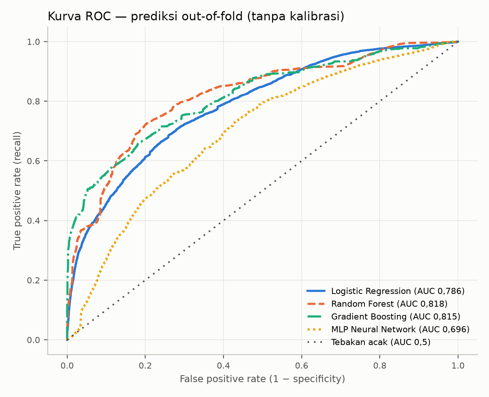
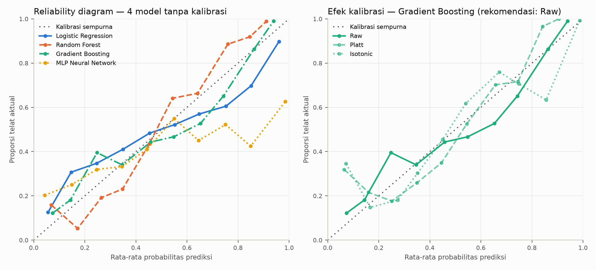
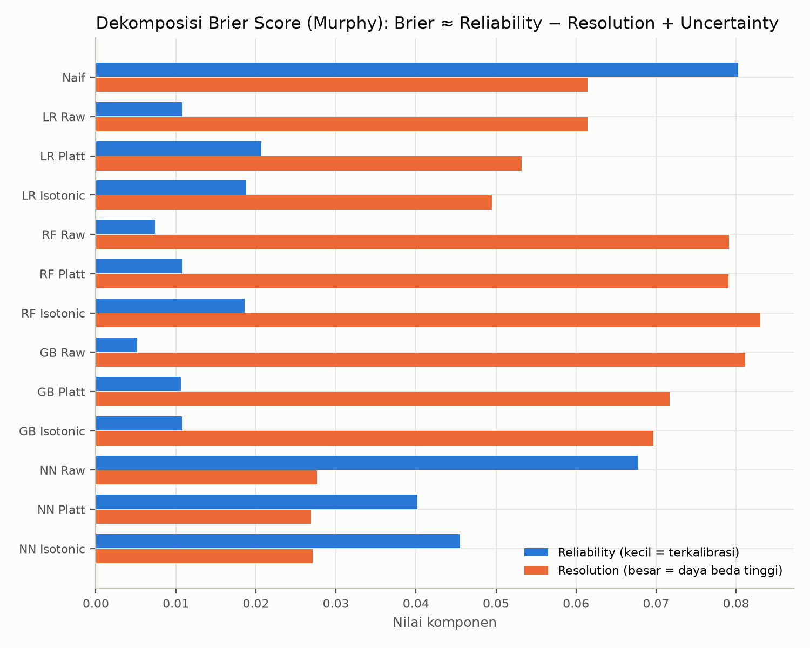
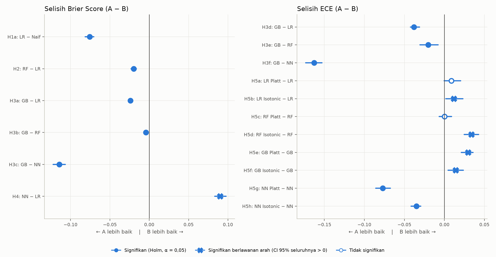
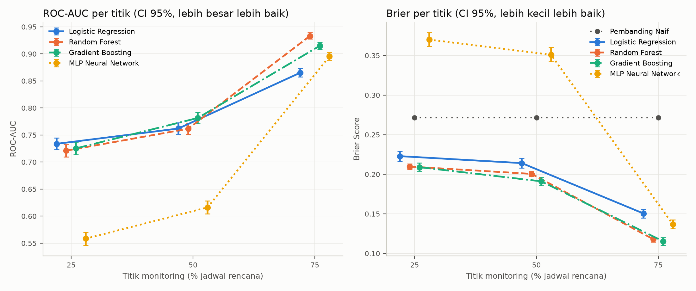
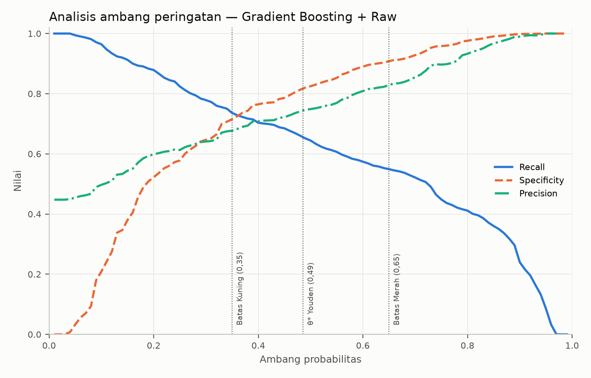
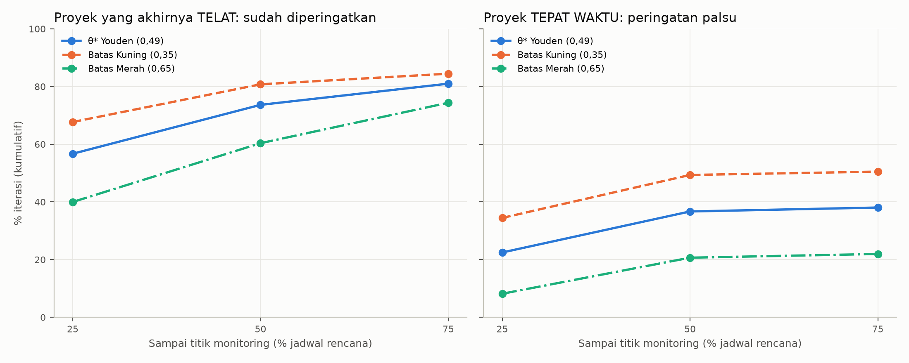
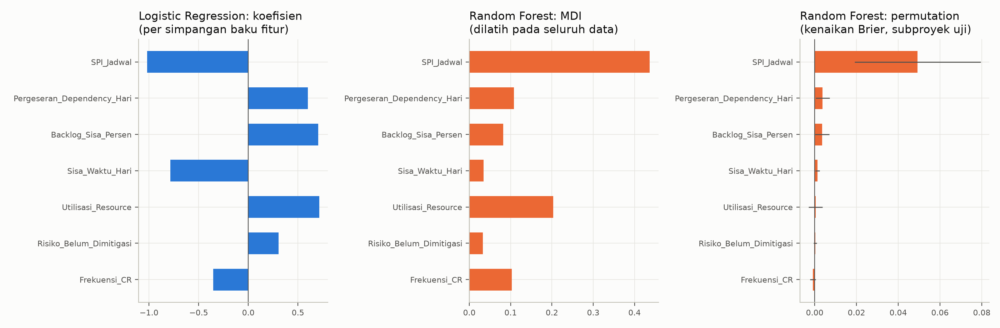

# BAB IV HASIL PENELITIAN

> **Status draf:** versi awal Pertemuan 6 (November 2026). Bab ini hanya memuat **hasil**: angka, tabel, grafik, dan
> keputusan uji hipotesis. Interpretasi, perbandingan dengan penelitian terdahulu, implikasi, dan keterbatasan dibahas
> pada Bab V (Pertemuan 7). Semua angka berasal dari `04_implemen_desain_eksperimen/hasil_eksperimen/` (Pertemuan 5)
> dan `04_implemen_desain_eksperimen/hasil_analisis/` (Pertemuan 6); jika skrip dijalankan ulang, angka di bab ini
> harus dicocokkan lagi dengan `hasil_analisis/00_RINGKASAN_ANALISIS.md`.
>
> Notasi: angka dalam kurung siku adalah selang kepercayaan (CI) 95% *bootstrap*. Desimal memakai koma.

---

## 4.1 Gambaran Data Hasil Simulasi

Simulasi iterasi random menghasilkan 24.000 observasi (8 subproyek × 1.000 iterasi × 3 titik monitoring). Sebanyak
44,8% observasi berlabel terlambat lebih dari 5% dari *baseline*. Proporsi ini sangat berbeda antarsubproyek
(Tabel 4.1).

**Tabel 4.1** Karakteristik keterlambatan per subproyek (1.000 iterasi per subproyek)

| Subproyek | *Baseline* $T$ (hari kerja, ±) | Rata-rata keterlambatan akhir (hari) | Terlambat > 5% | Terlambat > 10% |
| :--- | ---: | ---: | ---: | ---: |
| P-FNE-01 | 131 | 6,2 | 40,3% | 2,2% |
| P-FNE-02 | 232 | 5,9 | 0,4% | 0,0% |
| P-FNE-03 | 220 | 12,9 | 57,6% | 6,3% |
| P-FNE-04 | 120 | 18,6 | 98,9% | 82,4% |
| P-FNE-05 | 123 | 6,9 | 55,7% | 4,6% |
| P-FNE-06 | 120 | 5,9 | 38,1% | 6,7% |
| P-FNE-07 | 128 | 3,8 | 13,2% | 0,1% |
| P-FNE-08 | 62 | 3,4 | 54,0% | 2,4% |
| **Semua** | | | **44,8%** | |

$T$ diperkirakan dari hari monitoring titik 75% (hari monitoring ÷ 0,75).

## 4.2 Hasil Eksperimen 1–4: Perbandingan Model

Tabel 4.2 menyajikan kinerja keempat model (keluaran mentah, tanpa kalibrasi tambahan) dan pembanding naif. Semua
angka dihitung dari prediksi *out-of-fold* validasi *leave-one-subproject-out*.

**Tabel 4.2** Kinerja model tanpa kalibrasi tambahan (N = 24.000)

| Model | Brier Score ↓ | BSS ↑ | *Log Loss* ↓ | ECE ↓ | ROC-AUC ↑ |
| :--- | ---: | ---: | ---: | ---: | ---: |
| Pembanding naif | 0,2715 [0,2700; 0,2729] | 0 | 0,7371 | 0,1546 [0,1437; 0,1662] | – |
| *Logistic Regression* (LR) | 0,1958 [0,1904; 0,2008] | 0,279 [0,259; 0,299] | 0,5888 | 0,0939 [0,0863; 0,1017] | 0,786 [0,778; 0,795] |
| *Random Forest* (RF) | 0,1761 [0,1734; 0,1787] | 0,351 [0,341; 0,362] | 0,5313 | 0,0762 [0,0703; 0,0826] | 0,818 [0,811; 0,825] |
| *Gradient Boosting* (GB) | **0,1718** [0,1672; 0,1762] | **0,367** [0,351; 0,384] | **0,5158** | **0,0560** [0,0504; 0,0636] | 0,815 [0,806; 0,824] |
| *Neural Network* (NN, MLP sigmoid) | 0,2859 [0,2795; 0,2925] | −0,053 [−0,080; −0,028] | 1,6389 | 0,2188 [0,2113; 0,2277] | 0,696 [0,687; 0,704] |

↓ makin kecil makin baik; ↑ makin besar makin baik. ROC-AUC pembanding naif tidak dilaporkan karena prediksinya
konstan di setiap lipatan.

Hasil utama Tabel 4.2:

1. GB memiliki Brier Score, *Log Loss*, dan ECE terkecil; RF memiliki ROC-AUC tertinggi (0,818), sedikit di atas GB
   (0,815) dengan CI yang tumpang tindih.
2. LR, RF, dan GB memiliki BSS positif. NN memiliki BSS negatif (−0,053), artinya probabilitasnya kurang akurat
   dibanding pembanding naif, walaupun ROC-AUC-nya (0,696) di atas 0,5.
3. Kurva ROC keempat model disajikan pada Gambar 4.1.

**Gambar 4.1** Kurva ROC keempat model tanpa kalibrasi tambahan.

## 4.3 Hasil Eksperimen 5: Analisis Kalibrasi

### 4.3.1 Pengaruh Platt scaling dan isotonic regression

**Tabel 4.3** Brier Score dan ECE setiap kombinasi model × kalibrasi

| Model | Brier Raw | Brier Platt | Brier Isotonic | ECE Raw | ECE Platt | ECE Isotonic |
| :--- | ---: | ---: | ---: | ---: | ---: | ---: |
| LR | **0,1958** | 0,2145 | 0,2148 | **0,0939** | 0,1026 | 0,1058 |
| RF | **0,1761** | 0,1776 | 0,1860 | **0,0762** | 0,0765 | 0,1101 |
| GB | **0,1718** | 0,1860 | 0,1880 | **0,0560** | 0,0857 | 0,0701 |
| NN | 0,2859 | **0,2616** | 0,2633 | 0,2188 | **0,1417** | 0,1840 |

Untuk LR, RF, dan GB, keluaran mentah (Raw) memiliki Brier Score dan ECE terkecil. Kalibrasi tambahan hanya
memperbaiki NN, tetapi BSS NN setelah kalibrasi tetap kecil (Platt 0,036 [0,022; 0,050]; Isotonic 0,030 [0,013;
0,048]). Kombinasi dengan Brier Score dan ECE terkecil dari 12 kombinasi adalah **GB + Raw**, sehingga GB + Raw
menjadi model rekomendasi. Selisihnya terhadap kombinasi terbaik kedua (RF + Raw) adalah −0,0043 [−0,0066; −0,0020]
(uji dua arah, $p$ = 0,001).

**Gambar 4.2** *Reliability diagram*: kiri, keempat model tanpa kalibrasi; kanan, efek kalibrasi pada GB.

### 4.3.2 Calibration intercept dan slope

**Tabel 4.4** *Calibration intercept* (ideal 0) dan *calibration slope* (ideal 1), keluaran mentah

| Model | *Intercept* | *Slope* |
| :--- | ---: | ---: |
| LR | 0,155 [0,089; 0,220] | 0,586 [0,562; 0,610] |
| RF | −0,074 [−0,120; −0,032] | 1,555 [1,499; 1,614] |
| GB | 0,112 [0,054; 0,168] | 0,850 [0,820; 0,882] |
| NN | −1,585 [−1,722; −1,463] | 0,142 [0,134; 0,151] |

Pada keluaran mentah, tidak ada model yang CI *intercept*-nya memuat 0 sekaligus CI *slope*-nya memuat 1. *Slope* LR, GB, dan NN di bawah
1 (probabilitas terlalu ekstrem); *slope* RF di atas 1 (probabilitas terlalu dekat ke tengah). Setelah Platt
scaling, *slope* RF menjadi 1,007 [0,967; 1,051] dan *intercept*-nya −0,033 [−0,083; 0,013], keduanya memuat nilai
ideal, tetapi ECE RF tidak berubah (0,0762 → 0,0765).

### 4.3.3 Dekomposisi Brier Score

**Tabel 4.5** Dekomposisi Murphy, keluaran mentah (*uncertainty* = 0,2473 untuk semua model)

| Model | Brier | *Reliability* ↓ | *Resolution* ↑ |
| :--- | ---: | ---: | ---: |
| Pembanding naif | 0,2715 | 0,0802 | 0,0614 |
| LR | 0,1958 | 0,0108 | 0,0614 |
| RF | 0,1761 | 0,0074 | 0,0791 |
| GB | 0,1718 | **0,0051** | **0,0811** |
| NN | 0,2859 | 0,0678 | 0,0276 |

GB memiliki *reliability* terkecil dan *resolution* terbesar di antara keluaran mentah. NN memiliki *reliability*
terbesar kedua (setelah pembanding naif) dan *resolution* terkecil. Pada GB, kalibrasi Platt dan Isotonic
menaikkan *reliability* (0,0051 → 0,0106 dan 0,0108) dan menurunkan *resolution* (0,0811 → 0,0717 dan 0,0696).
Dekomposisi semua kombinasi disajikan pada Gambar 4.3.

**Gambar 4.3** Komponen *reliability* dan *resolution* Brier Score untuk 13 kombinasi.

## 4.4 Pengujian Hipotesis

Hipotesis H1–H5 (Bagian 3.11.1) diuji dengan 17 uji selisih berpasangan satu arah dan koreksi Holm. Kolom
"Subproyek searah" menunjukkan pada berapa dari delapan subproyek uji selisihnya searah dengan hipotesis.

**Tabel 4.6** Hasil uji selisih

| Uji | Perbandingan (A − B) | Metrik | Selisih [CI 95%] | $p$ Holm | Subproyek searah | $p$ Wilcoxon |
| :--- | :--- | :--- | ---: | ---: | ---: | ---: |
| H1a | LR − naif | Brier | −0,0757 [−0,0813; −0,0703] | 0,009 ✓ | 6/8 | 0,098 |
| H2 | RF − LR | Brier | −0,0197 [−0,0232; −0,0163] | 0,009 ✓ | 4/8 | 0,273 |
| H3a | GB − LR | Brier | −0,0240 [−0,0266; −0,0214] | 0,009 ✓ | 4/8 | 0,156 |
| H3b | GB − RF | Brier | −0,0043 [−0,0066; −0,0020] | 0,009 ✓ | 5/8 | 0,273 |
| H3c | GB − NN | Brier | −0,1141 [−0,1220; −0,1066] | 0,009 ✓ | 5/8 | 0,074 |
| H3d | GB − LR | ECE | −0,0379 [−0,0425; −0,0310] | 0,009 ✓ | 4/8 | 0,422 |
| H3e | GB − RF | ECE | −0,0202 [−0,0306; −0,0078] | 0,009 ✓ | 5/8 | 0,371 |
| H3f | GB − NN | ECE | −0,1628 [−0,1733; −0,1530] | 0,009 ✓ | 6/8 | 0,039 |
| H4 | NN − LR | Brier | +0,0901 [+0,0832; +0,0977] | 1,000 ✗ | 3/8 | 0,727 |
| H5a | LR Platt − LR | ECE | +0,0087 [−0,0004; +0,0203] | 1,000 | 2/8 | 0,945 |
| H5b | LR Isotonic − LR | ECE | +0,0119 [+0,0016; +0,0232] | 1,000 ✗ | 3/8 | 0,809 |
| H5c | RF Platt − RF | ECE | +0,0003 [−0,0065; +0,0090] | 1,000 | 4/8 | 0,473 |
| H5d | RF Isotonic − RF | ECE | +0,0339 [+0,0247; +0,0428] | 1,000 ✗ | 4/8 | 0,527 |
| H5e | GB Platt − GB | ECE | +0,0297 [+0,0210; +0,0358] | 1,000 ✗ | 1/8 | 0,988 |
| H5f | GB Isotonic − GB | ECE | +0,0141 [+0,0045; +0,0236] | 1,000 ✗ | 3/8 | 0,844 |
| H5g | NN Platt − NN | ECE | −0,0771 [−0,0857; −0,0675] | 0,009 ✓ | 5/8 | 0,230 |
| H5h | NN Isotonic − NN | ECE | −0,0348 [−0,0416; −0,0294] | 0,009 ✓ | 4/8 | 0,320 |

✓ signifikan sesuai hipotesis (Holm, α = 0,05); ✗ CI 95% seluruhnya di atas nol (berlawanan arah dengan hipotesis).
Nilai $p$ Holm terkecil 0,009 adalah batas bawah prosedur ($17 \times 1/2001$), karena tidak ada satu pun replikasi
*bootstrap* yang berlawanan arah.

**Gambar 4.4** Selisih metrik dan CI 95% setiap uji. Titik di kiri garis nol berarti model A lebih baik.

**Tabel 4.7** Keputusan hipotesis

| Hipotesis | Pernyataan | Keputusan | Dasar |
| :--- | :--- | :--- | :--- |
| H1 | LR lebih akurat daripada pembanding naif dan terkalibrasi baik | **Diterima sebagian** | H1a signifikan; CI *intercept* LR [0,089; 0,220] tidak memuat 0 dan CI *slope* [0,562; 0,610] tidak memuat 1 |
| H2 | RF lebih akurat daripada LR | **Diterima** | H2 signifikan |
| H3 | GB memiliki Brier dan ECE terkecil dibanding LR, RF, NN | **Diterima** | H3a–H3f signifikan |
| H4 | NN lebih akurat daripada LR | **Ditolak** | Selisih berlawanan arah: Brier NN lebih besar 0,0901 |
| H5 | Kalibrasi Platt/Isotonic menurunkan ECE | **Ditolak** | Hanya 2 dari 8 pasangan membaik (keduanya NN); 4 pasangan memburuk signifikan |

Pada uji konsistensi antarsubproyek (Wilcoxon, delapan selisih per subproyek), hanya H3f (ECE GB lebih kecil dari
NN, 6/8 subproyek, $p$ = 0,039) yang signifikan pada α = 0,05. Keunggulan pada uji lainnya signifikan pada gabungan
seluruh iterasi, tetapi tidak konsisten di setiap subproyek: misalnya RF lebih akurat daripada LR hanya pada 4 dari
8 subproyek, dan GB lebih akurat daripada RF pada 5 dari 8 subproyek.

## 4.5 Hasil per Titik Monitoring

**Tabel 4.8** ROC-AUC dan Brier Score per titik monitoring (keluaran mentah)

| Model | AUC 25% | AUC 50% | AUC 75% | Brier 25% | Brier 50% | Brier 75% |
| :--- | ---: | ---: | ---: | ---: | ---: | ---: |
| LR | 0,734 [0,723; 0,745] | 0,762 [0,751; 0,773] | 0,865 [0,857; 0,873] | 0,2229 | 0,2141 | 0,1504 |
| RF | 0,721 [0,709; 0,732] | 0,762 [0,751; 0,772] | **0,933** [0,927; 0,939] | 0,2098 | 0,2005 | 0,1180 |
| GB | 0,725 [0,714; 0,737] | **0,782** [0,771; 0,792] | 0,915 [0,909; 0,921] | **0,2089** | **0,1911** | **0,1154** |
| NN | 0,558 [0,546; 0,570] | 0,616 [0,604; 0,628] | 0,895 [0,888; 0,902] | 0,3700 | 0,3509 | 0,1368 |

Brier Score pembanding naif sama di ketiga titik (0,2715) karena label setiap iterasi sama di ketiga titik. Untuk
semua model, ROC-AUC naik dan Brier Score turun dari titik 25% ke 50% dan dari 50% ke 75%, dengan CI selisih yang
tidak memuat nol. Pada GB, ROC-AUC naik 0,056 [0,048; 0,065] dari 25% ke 50% dan 0,133 [0,125; 0,142] dari 50% ke
75%. Pada titik 25%, CI ROC-AUC LR, RF, dan GB saling tumpang tindih; pada titik 75%, RF memiliki ROC-AUC tertinggi.

**Gambar 4.5** ROC-AUC dan Brier Score per titik monitoring dengan CI 95%.

## 4.6 Analisis Ambang Peringatan Dini

Ambang Youden model rekomendasi (GB + Raw) adalah $\theta^*$ = 0,485 ($J$ = 0,476). Tabel 4.9 membandingkan
$\theta^*$ dengan batas zona Kuning (0,35) dan Merah (0,65).

**Tabel 4.9** Kinerja peringatan pada tiga ambang (seluruh titik monitoring)

| Ambang | Observasi diberi peringatan | *Recall* | *Specificity* | *Precision* | F1 |
| :--- | ---: | ---: | ---: | ---: | ---: |
| Batas Kuning 0,35 | 48,7% | 73,6% | 71,5% | 67,7% | 0,705 |
| $\theta^*$ Youden 0,485 | 39,4% | 65,7% | 81,9% | 74,6% | 0,699 |
| Batas Merah 0,65 | 29,7% | 54,9% | 90,8% | 82,9% | 0,661 |

Menaikkan ambang menurunkan *recall* dan menaikkan *specificity* serta *precision* (Gambar 4.6). Pada $\theta^*$,
*recall* naik dari 56,7% (titik 25%) ke 67,0% (50%) dan 73,5% (75%), dan *precision* naik dari 67,2% ke 69,2% dan
88,7%.

**Gambar 4.6** *Recall*, *specificity*, dan *precision* GB + Raw untuk ambang 0,01–0,99.

**Tabel 4.10** Deteksi dini kumulatif per iterasi (GB + Raw)

| Ambang | Proyek terlambat sudah diperingatkan s.d. 25% / 50% / 75% | Tidak pernah diperingatkan | Proyek tepat waktu diperingatkan palsu s.d. 25% / 50% / 75% |
| :--- | ---: | ---: | ---: |
| Batas Kuning 0,35 | 67,7% / 80,8% / 84,5% | 15,5% | 34,4% / 49,3% / 50,5% |
| $\theta^*$ 0,485 | 56,7% / 73,6% / 81,0% | 19,0% | 22,5% / 36,7% / 38,0% |
| Batas Merah 0,65 | 40,0% / 60,4% / 74,4% | 25,6% | 8,2% / 20,7% / 22,0% |

Dengan $\theta^*$, 56,7% iterasi yang akhirnya terlambat sudah diperingatkan pada titik 25% jadwal dan 81,0% sudah
pernah diperingatkan sampai titik 75%. Sebaliknya, 38,0% iterasi yang akhirnya tepat waktu pernah menerima
peringatan palsu sampai titik 75%. Rata-rata sisa waktu saat peringatan pertama untuk proyek terlambat adalah 92,3
hari kerja (median 90,0).

**Gambar 4.7** Persentase kumulatif proyek terlambat yang sudah diperingatkan (kiri) dan proyek tepat waktu yang
menerima peringatan palsu (kanan).

## 4.7 Hasil per Subproyek

**Tabel 4.11** Kinerja GB + Raw per subproyek uji

| Subproyek | Proporsi terlambat | Rata-rata prediksi | Prediksi naif | Brier | BSS | ECE | ROC-AUC |
| :--- | ---: | ---: | ---: | ---: | ---: | ---: | ---: |
| P-FNE-01 | 40,3% | 29,6% | 45,4% | 0,1930 | 0,206 | 0,1100 | 0,790 |
| P-FNE-02 | 0,4% | 13,0% | 51,1% | 0,0214 | 0,918 | 0,1263 | 0,683 |
| P-FNE-03 | 57,6% | 61,4% | 42,9% | 0,1733 | 0,348 | 0,0559 | 0,819 |
| P-FNE-04 | 98,9% | 80,3% | 37,0% | 0,0764 | 0,806 | 0,1864 | 0,925 |
| P-FNE-05 | 55,7% | 67,0% | 43,2% | 0,1816 | 0,308 | 0,1255 | 0,836 |
| P-FNE-06 | 38,1% | 38,9% | 45,7% | 0,1647 | 0,318 | 0,0294 | 0,795 |
| P-FNE-07 | 13,2% | 39,7% | 49,3% | 0,1972 | 0,194 | 0,2653 | 0,761 |
| P-FNE-08 | 54,0% | 14,7% | 43,5% | 0,3668 | −0,414 | 0,3935 | 0,796 |

GB + Raw memiliki BSS positif pada tujuh subproyek. Pada P-FNE-08, rata-rata prediksi (14,7%) jauh di bawah proporsi
terlambat aktual (54,0%) sehingga BSS-nya negatif (−0,414), walaupun ROC-AUC-nya 0,796. Selisih rata-rata prediksi
dan proporsi aktual juga besar pada P-FNE-07 (39,7% vs 13,2%) dan P-FNE-04 (80,3% vs 98,9%). P-FNE-08 memiliki
*baseline* terpendek (±62 hari kerja) dan rata-rata utilisasi sumber daya terendah (0,048), dan ROC-AUC P-FNE-02 hanya
dihitung dari 12 observasi terlambat.

## 4.8 Kepentingan Variabel

**Tabel 4.12** *Permutation importance* GB + Raw pada subproyek uji (kenaikan Brier Score, 8 lipatan)

| Peringkat | Variabel | Rata-rata | SD antarlipatan | Lipatan positif |
| ---: | :--- | ---: | ---: | ---: |
| 1 | $X_1$ SPI jadwal | 0,0782 | 0,0541 | 8/8 |
| 2 | $X_3$ Backlog sisa | 0,0072 | 0,0096 | 7/8 |
| 3 | $X_2$ Sisa waktu | 0,0063 | 0,0096 | 6/8 |
| 4 | $X_4$ Utilisasi sumber daya | 0,0014 | 0,0117 | 1/8 |
| 5 | $X_5$ Risiko belum dimitigasi | −0,0000 | 0,0002 | 4/8 |
| 6 | $X_7$ Pergeseran *dependency* | −0,0003 | 0,0009 | 3/8 |
| 7 | $X_6$ Frekuensi CR | −0,0010 | 0,0024 | 1/8 |

SPI jadwal adalah satu-satunya variabel yang menaikkan Brier Score pada semua lipatan bila diacak. Variabel $X_5$,
$X_6$, dan $X_7$ memiliki rata-rata kepentingan ≤ 0 pada GB. Peringkat ini konsisten dengan *permutation importance*
RF dan koefisien LR pada Pertemuan 5 untuk $X_1$ (koefisien LR −1,017 per simpangan baku; *odds ratio* 0,362),
sedangkan koefisien LR untuk $X_7$ bernilai +0,598 (*odds ratio* 1,819).

**Gambar 4.8** Koefisien LR, MDI RF, dan *permutation importance* RF (Pertemuan 5).

## 4.9 Analisis Sensitivitas Faktor Mitigasi

**Tabel 4.13** GB + Raw pada dataset dengan faktor mitigasi $f$ berbeda

| $f$ | Proporsi terlambat | Brier | BSS | ECE | ROC-AUC |
| ---: | ---: | ---: | ---: | ---: | ---: |
| 0,2 | 26,9% | 0,1312 | 0,383 | 0,0293 | 0,837 |
| **0,4 (utama)** | 44,8% | 0,1718 | 0,367 | 0,0560 | 0,815 |
| 1,0 | 75,1% | 0,1654 | 0,258 | 0,1137 | 0,771 |

BSS GB tetap positif pada ketiga nilai $f$, tetapi ECE naik dan ROC-AUC turun saat $f$ = 1,0.

## 4.10 Ringkasan Hasil

| No | Hasil |
| :---: | :--- |
| 1 | GB + Raw adalah model rekomendasi: Brier 0,1718 [0,1672; 0,1762], BSS 0,367, ECE 0,0560, ROC-AUC 0,815. |
| 2 | H2 dan H3 diterima, H1 diterima sebagian, H4 dan H5 ditolak. |
| 3 | Kalibrasi Platt/Isotonic tidak memperbaiki LR, RF, dan GB; hanya memperbaiki NN yang keluaran mentahnya terburuk. |
| 4 | Keunggulan antarmodel signifikan pada gabungan iterasi, tetapi tidak konsisten di setiap subproyek (uji Wilcoxon). |
| 5 | Ketepatan prediksi naik seiring waktu: ROC-AUC GB 0,725 → 0,782 → 0,915 pada titik 25% → 50% → 75%. |
| 6 | Pada $\theta^*$ = 0,485, 56,7% proyek terlambat sudah diperingatkan pada titik 25% dan 81,0% sampai titik 75%, dengan peringatan palsu kumulatif 38,0%. |
| 7 | Prediksi GB meleset jauh pada P-FNE-08 (BSS −0,414). |
| 8 | SPI jadwal adalah variabel paling berpengaruh; risiko belum dimitigasi, frekuensi CR, dan pergeseran *dependency* hampir tidak berpengaruh pada GB. |
