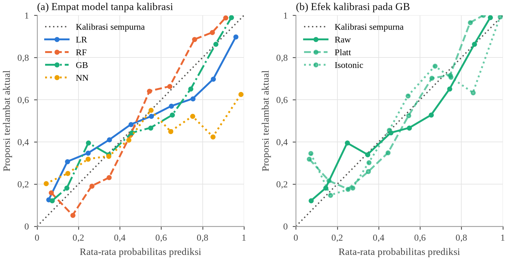
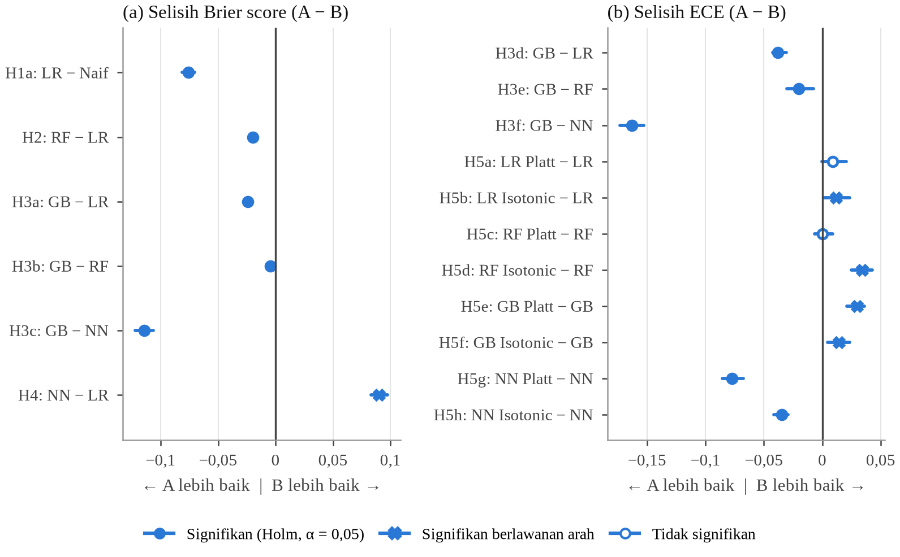
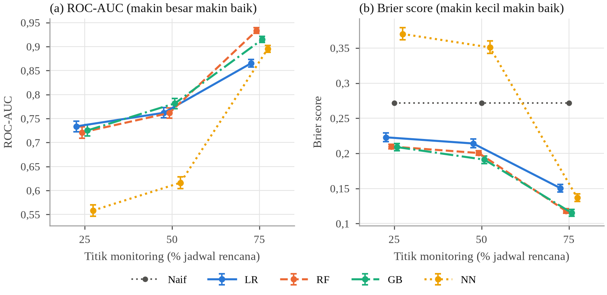
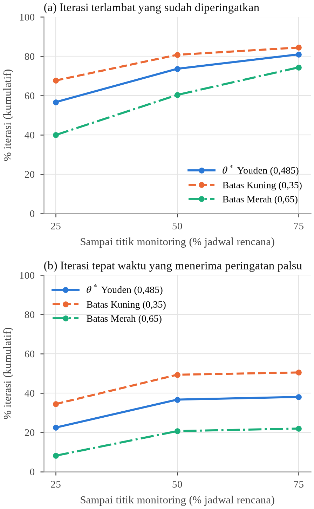

<!-- Naskah sumber. Sitasi ditulis sebagai [@kunci]; jalankan `python susun_paper.py` untuk menghasilkan
Paper_PRE02_Pustaka_Data.md (sitasi bernomor + Daftar Rujukan) dan .docx. Jangan sunting berkas hasil. -->

::: {custom-style="Penulis"}
Muktibaskara Kusbianto^1^, Muhammad Abdillah Kais Al Akmal^2^, Muhammad Ainul Yaqin^3^
:::

::: {custom-style="Afiliasi"}
Fakultas Sains dan Teknologi, Universitas Islam Negeri Maulana Malik Ibrahim Malang

^1^muktibaskrakusbianto@gmail.com, ^2^abdillahkais1@gmail.com, ^3^yaqinov@ti.uin-malang.ac.id
:::

**Abstract**

*Project managers need the probability of delay, not just a risk label. This study predicts the probability that a resource-constrained project finishes more than 5% beyond its baseline and tests their calibration on unseen projects. Because the eight subprojects of the Super ERP Farm Nation Enterprise portfolio have not been executed, synthetic data were generated by simulating their schedules, shared resources, change requests, and risk registers, giving 24,000 observations at three monitoring points. Logistic Regression, Random Forest, Gradient Boosting, and a neural network were evaluated with leave-one-subproject-out validation, with and without Platt and isotonic calibration. On the pooled data, uncalibrated Gradient Boosting was the most accurate and best calibrated (Brier score 0.172, Brier skill score 0.367, ECE 0.056, ROC-AUC 0.815), but its advantage was inconsistent across subprojects and its mean per-subproject ECE was 0.162. The neural network was overconfident and worse than a naive baseline. Post-hoc calibration did not help tree-based models because it did not transfer between projects with different base delay rates. ROC-AUC rose from 0.725 to 0.915 as projects progressed, and 56.7% of late runs were flagged at one quarter of the schedule. Cross-project probabilities should therefore be recalibrated on the running project before use as warnings.*

*Keywords: project delay prediction, probability calibration, early warning system, resource-constrained projects, simulation*

**Abstrak**

Manajer proyek membutuhkan peluang keterlambatan, bukan sekadar label berisiko. Penelitian ini memprediksi probabilitas proyek dengan sumber daya terbatas selesai lebih dari 5% melewati *baseline* dan menguji kalibrasinya pada proyek yang tidak dipakai melatih model. Karena delapan subproyek portofolio Super ERP Farm Nation Enterprise belum dilaksanakan, data sintetis dibangkitkan dengan simulasi jadwal, sumber daya bersama, *change request*, dan register risiko dari dokumen *Project Management Plan*, menghasilkan 24.000 observasi pada tiga titik *monitoring*. *Logistic Regression*, *Random Forest*, *Gradient Boosting*, dan *neural network* dievaluasi dengan validasi *leave-one-subproject-out*, dengan dan tanpa kalibrasi Platt serta *isotonic regression*. Pada data gabungan, *Gradient Boosting* tanpa kalibrasi tambahan paling akurat dan paling terkalibrasi (*Brier score* 0,172; *Brier skill score* 0,367; ECE 0,056; ROC-AUC 0,815), tetapi keunggulannya tidak konsisten antarsubproyek dan rata-rata ECE per subproyeknya 0,162. *Neural network* terlalu yakin dan berkinerja lebih buruk daripada pembanding naif. Kalibrasi pascalatih tidak memperbaiki model berbasis pohon karena tidak berpindah antarproyek yang tingkat keterlambatan dasarnya berbeda. ROC-AUC naik dari 0,725 menjadi 0,915 seiring kemajuan proyek, dan 56,7% iterasi yang berakhir terlambat sudah diperingatkan pada seperempat jadwal. Probabilitas dari model lintas proyek karenanya perlu dikalibrasi ulang dengan data proyek yang sedang berjalan sebelum dipakai sebagai peringatan dini.

Kata kunci: prediksi keterlambatan proyek, kalibrasi probabilitas, sistem peringatan dini, proyek dengan sumber daya terbatas, simulasi

# 1. Pendahuluan

Keterlambatan merupakan masalah yang terus berulang pada proyek implementasi sistem enterprise. Proyek implementasi *Enterprise Resource Planning* (ERP) melibatkan jaringan interaksi pemangku kepentingan yang kompleks dari berbagai unit organisasi, dan pengelolaan yang tidak efektif sering menjadi penyebab kegagalan proyek [@ananta]. Masalah ini diperberat pada proyek multi sumber daya terbatas, yaitu proyek yang aktivitasnya membutuhkan beberapa jenis sumber daya (peran) dengan jumlah terbatas yang dipakai bersama. Keterlambatan satu aktivitas dapat menahan aktivitas lain yang menunggu sumber daya yang sama. Kinerja penjadwalan pada lingkungan multiproyek dengan sumber daya terbatas sangat bergantung pada kompleksitas jaringan aktivitas serta distribusi dan perebutan sumber daya [@browning]. Pengendalian proyek secara konvensional bertumpu pada *Earned Value Management* (EVM), yang membandingkan nilai pekerjaan yang telah diselesaikan (*earned value*, EV) dengan nilai pekerjaan yang direncanakan (*planned value*, PV). Rasio keduanya, *Schedule Performance Index* (SPI = EV/PV), dipakai untuk meramalkan durasi akhir secara deterministik [@batselier]. Pendekatan ini menghasilkan satu angka estimasi tanpa menyatakan seberapa yakin estimasi tersebut.

Pembelajaran mesin mulai dipakai untuk mengatasi keterbatasan tersebut. Metode kecerdasan buatan terbukti mengungguli metode EVM dalam meramalkan durasi proyek, dengan syarat data latih dan data uji memiliki karakter yang mirip [@wauters]. Tabel 1 merangkum studi prediksi keterlambatan yang paling dekat dengan penelitian ini. Domainnya beragam, mulai dari *issue* dan *epic* perangkat lunak [@choetkiertikul; @kula], proyek konstruksi [@gondia], proyek ERP berbasis *cloud* [@haekal], sampai pesanan manufaktur [@impivaara] dan produksi [@kannan]. Keluarannya berupa label biner, kelas risiko, atau estimasi keterlambatan, dan metrik utama yang dilaporkan adalah metrik klasifikasi atau daya beda seperti akurasi, F1, dan ROC-AUC, yaitu luas di bawah kurva *receiver operating characteristic* yang mengukur kemampuan model membedakan dua kelas. Angka tertinggi justru berasal dari data yang kecil atau tidak dijelaskan, misalnya AUC 0,997 dari 100 data [@haekal] dan akurasi 0,93 tanpa keterangan sumber data [@mandapatti].

Tabel 1. Sintesis studi prediksi keterlambatan terdahulu

| Studi | Domain dan data | Model dan metrik utama |
| :--- | :--- | :--- |
| Choetkiertikul dkk. [@choetkiertikul] | *Issue* perangkat lunak, 8 proyek *open source* | Faktor risiko + *classifier*; ROC-AUC 0,83 |
| Kula dkk. [@kula] | 4.040 *epic* dari 270 tim satu perusahaan | Bayesian dinamis; estimasi diperbarui sepanjang proyek |
| Gondia dkk. [@gondia] | Proyek konstruksi | *Decision tree*, *naive Bayes*; kelas risiko keterlambatan |
| Haekal dkk. [@haekal] | Proyek ERP *cloud*, 100 data | RF; AUC 0,997 |
| Impivaara [@impivaara] | Pesanan manufaktur, satu perusahaan | LightGBM; ROC-AUC 0,943 |
| Kannan dkk. [@kannan] | Produksi tambang, dua mesin | MLP dan LR; *F-measure* 0,973 |
| Mandapatti [@mandapatti] | Proyek perangkat lunak, data tidak dilaporkan | GB; akurasi 0,93 |
| Fitzsimmons dkk. [@fitzsimmons] | 293.263 tugas dari 302 proyek konstruksi | Hibrida simulasi dan pembelajaran mesin; akurasi analisis risiko jadwal |
| Penelitian ini | 8 subproyek ERP, 24.000 observasi sintetis | LR, RF, GB, NN dengan kalibrasi; *Brier score*, ECE, ROC-AUC per subproyek |

Metrik daya beda tidak mengukur apakah angka probabilitasnya dapat dipercaya. Probabilitas 0,8 baru bermakna bila sekitar 80% proyek dengan nilai tersebut benar-benar terlambat, yaitu bila model terkalibrasi [@niculescu]. Kalibrasi tidak dapat diasumsikan: *boosted trees* dan SVM cenderung mendistorsi probabilitas [@niculescu], sedangkan jaringan saraf modern cenderung terlalu yakin [@guo]. *Monitoring* prediktif yang memberi sinyal penyimpangan saat proses berjalan telah diusulkan pada proses bisnis [@cabanillas]. Bila sinyal semacam itu berupa probabilitas yang dibandingkan dengan ambang, sistem peringatan dini hanya dapat diandalkan jika probabilitasnya terkalibrasi.

Dari sintesis tersebut terdapat tiga celah. Pertama, kalibrasi probabilitas keterlambatan belum menjadi bagian evaluasi utama, termasuk pertanyaan apakah kalibrasi yang dipelajari dari sekumpulan proyek berlaku untuk proyek lain yang tingkat keterlambatan dasarnya berbeda. Syarat kemiripan data latih dan data uji [@wauters] justru paling dipertaruhkan ketika model dipakai pada proyek baru. Kedua, data latih studi tersebut jarang memuat dependensi aktivitas dan perebutan sumber daya terbatas sekaligus, padahal keduanya memengaruhi kinerja jadwal [@browning; @kula]. Ketiga, proyek yang belum berjalan tidak memiliki data historis. Penggabungan simulasi dengan pembelajaran mesin telah terbukti meningkatkan akurasi analisis risiko jadwal [@fitzsimmons], sehingga data latih dapat dibangkitkan dari rencana proyek, dengan konsekuensi bahwa hasilnya berlaku sejauh asumsi simulasinya berlaku.

Penelitian ini bertujuan membangun dan membandingkan model yang memprediksi probabilitas keterlambatan proyek multi sumber daya terbatas dari kondisi aktual pada tahap *monitoring*. Tiga pertanyaan penelitian dirumuskan. RQ1: model mana yang menghasilkan probabilitas keterlambatan paling akurat pada subproyek yang tidak pernah dilihatnya? RQ2: apakah probabilitas tersebut terkalibrasi, dan apakah kalibrasi pascalatih yang dipelajari dari subproyek lain memperbaikinya? RQ3: seberapa dini dan pada ambang berapa peringatan dapat diberikan, serta variabel apa yang paling menentukan? Kontribusi utama penelitian ini adalah bukti, meskipun pada data sintetis, bahwa probabilitas keterlambatan yang tampak terkalibrasi pada data gabungan dapat salah kalibrasi pada tingkat proyek, dan bahwa kalibrasi pascalatih tidak berpindah antarproyek. Kontribusi pendukungnya adalah prosedur pembangkitan data latih dari dokumen *Project Management Plan* (PMP) yang setiap parameternya dirujuk ke dokumen atau dinyatakan sebagai asumsi, serta analisis waktu dan ambang peringatan dini. Kebaruan tersebut terletak pada cara evaluasi, sedangkan portofolio yang dikaji berperan sebagai kasus penerapan.

# 2. Metode Penelitian

## 2.1. Objek dan sumber data

Objek penelitian adalah portofolio Super ERP Farm Nation Enterprise 2026 yang terdiri atas delapan subproyek (P-FNE-01 sampai P-FNE-08) dengan sumber daya terbatas. Sumber data adalah dokumen PMP setiap subproyek. Dari dokumen tersebut diekstraksi 337 aktivitas beserta durasi dan dependensinya, alokasi sumber daya per peran, serta 171 risiko dari register risiko. Sebanyak 148 risiko disimulasikan; risiko perubahan lingkup tidak disimulasikan karena sudah diwakili oleh *change request* (CR), dan risiko biaya murni tidak disimulasikan karena tidak menggeser jadwal. Sumber daya dipakai bersama oleh aktivitas di dalam subproyek yang sama; pemakaian sumber daya bersama antarsubproyek tidak dimodelkan.

## 2.2. Pembangkitan data dengan simulasi iterasi random

Proyek belum dilaksanakan sehingga data realisasi belum tersedia. Data latih sintetis dibangkitkan dengan simulasi iterasi random yang menjalankan setiap subproyek 1.000 kali. Aktivitas dimulai satu hari setelah seluruh pendahulunya selesai dan hanya jika semua orang yang dibutuhkannya sedang tidak bekerja; aktivitas yang menunggu diantrekan dengan aturan *first come first served*. Jadwal tanpa gangguan menjadi *baseline* $T$.

Pada setiap iterasi, setiap aktivitas terkena CR dengan peluang 0,10. Kelas kesulitan CR rendah, sedang, dan tinggi (60%, 30%, 10%) menambah durasi aktivitas sebesar 10–20%, 30%, dan 50%. Peluang dan pembagian kelas ini merupakan asumsi pemodelan karena PMP tidak memuat frekuensi historis CR. Setiap risiko $r$ terjadi dengan peluang $p_r$ dari register, yaitu skala 1–5 yang dikonversi menjadi 0,1; 0,3; 0,5; 0,7; 0,9 sesuai *Probability-Impact Matrix* PMP-01. Risiko yang terjadi menimpa satu aktivitas $i$ yang sedang berjalan pada hari acak dan menambah durasi rencananya $d_i$ sebesar

$$\Delta d_i = d_i \times s(\ell_r) \times f $$

dengan $s(\ell_r)$ skala dampak jadwal PMP-01 untuk level dampak $\ell_r$ = 1–5 (0,5%; 3%; 7,5%; 15%; 25%) dan $f$ faktor mitigasi. Nilai $f = 0{,}4$ dipilih karena menghasilkan median keterlambatan P-FNE-08 sebesar 5,3%, paling dekat dengan hasil analisis risiko kuantitatif dokumen PMP-08 (target 20 minggu, P50 21 minggu). Faktor $f$ adalah parameter pembangkit data yang ditetapkan sebelum model dilatih. Karena nilainya diacu dari P-FNE-08, subproyek ini tidak sepenuhnya independen dari proses pembangkitan data; pengaruh nilai $f$ diperiksa dengan analisis sensitivitas (subbab 3.8).

Setiap iterasi dipantau pada titik 25%, 50%, dan 75% dari $T$, sehingga diperoleh 8 × 1.000 × 3 = 24.000 observasi. Variabel bebas dihitung hanya dari kejadian sampai hari *monitoring* $t$, sehingga model tidak memakai informasi masa depan.

## 2.3. Variabel penelitian

Tabel 2 menyajikan tujuh variabel bebas dan variabel terikat. Ambang 5% mengikuti aturan pengendalian perubahan jadwal PMP-01, yaitu perubahan jadwal lebih dari 5% *baseline* harus disetujui sponsor proyek. Penelitian ini hanya memprediksi status keterlambatan; besaran keterlambatan, biaya, dan waktu sampai keterlambatan terjadi tidak dicakup.

Tabel 2. Variabel penelitian

| Variabel | Definisi operasional |
| :--- | :--- |
| *X*~1~ SPI jadwal | EV(*t*)/PV(*t*) berbasis porsi durasi yang telah dikerjakan |
| *X*~2~ Sisa waktu | *T* − *t* (hari kerja) |
| *X*~3~ *Backlog* sisa | 1 − EV(*t*)/Σ*d*~*i*~ |
| *X*~4~ Utilisasi sumber daya | Hari-orang terpakai ÷ hari-orang tersedia sampai *t* |
| *X*~5~ Risiko belum dimitigasi | Jumlah risiko yang telah terjadi dan aktivitasnya belum selesai |
| *X*~6~ Frekuensi CR | Jumlah CR pada aktivitas yang sudah dimulai |
| *X*~7~ Pergeseran *dependency* | Rata-rata pergeseran hari siap aktivitas akibat pendahulunya |
| *Y* Status keterlambatan | 1 jika keterlambatan akhir > 5% dari *T* |

## 2.4. Model, validasi, dan kalibrasi

Empat model dibandingkan, yaitu *Logistic Regression* (LR, penalti L2, $C = 1$), *Random Forest* (RF, 100 pohon, kedalaman maksimum 3), *Gradient Boosting* (GB, 100 tahap, *learning rate* 0,05, kedalaman 2, *subsample* 0,8) [@friedman], dan *neural network* (NN) dengan dua lapis tersembunyi 16 dan 8 neuron beraktivasi ReLU serta keluaran sigmoid. NN dilatih dengan Adam (*learning rate* 0,01, regularisasi L2 0,01, maksimum 1.000 epoh) tanpa *early stopping*. Setiap model didahului standardisasi variabel yang dipasang hanya pada data latih setiap lipatan. Sebagai patokan dipakai pembanding naif yang selalu memprediksi proporsi terlambat pada data latih. Hiperparameter ditetapkan sebelum eksperimen tanpa *tuning*, *seed* acak 42, dan seluruh model dibangun dengan scikit-learn 1.9.1 [@pedregosa].

Observasi dari subproyek yang sama sangat mirip, sehingga validasi dilakukan dengan *leave-one-subproject-out*: model dilatih pada tujuh subproyek dan diuji pada subproyek kedelapan, diulang delapan kali. Setiap observasi diprediksi tepat satu kali oleh model yang tidak pernah melihat subproyeknya (prediksi *out-of-fold*). Setiap model diuji tanpa kalibrasi tambahan (Raw), dengan *Platt scaling* [@platt], dan dengan *isotonic regression* [@zadrozny]. Kalibrator dilatih dengan validasi silang dalam tiga lipatan yang dikelompokkan per subproyek pada data latih, sehingga kalibrator juga tidak pernah melihat subproyek uji. Model rekomendasi adalah kombinasi dengan *Brier score* terendah.

## 2.5. Metrik dan analisis

Akurasi probabilitas diukur dengan *Brier score* [@brier]

$$\mathrm{BS} = \frac{1}{N}\sum_{i=1}^{N}(p_i - y_i)^2 $$

dengan $p_i$ probabilitas prediksi dan $y_i$ label observasi ke-$i$, serta *Brier skill score* $\mathrm{BSS} = 1 - \mathrm{BS}_{\text{model}}/\mathrm{BS}_{\text{naif}}$, dengan nilai positif berarti lebih baik daripada pembanding naif. Kalibrasi diukur dengan *expected calibration error* [@guo]

$$\mathrm{ECE} = \sum_{m=1}^{10}\frac{|B_m|}{N}\left|\bar{y}(B_m) - \bar{p}(B_m)\right| $$

dengan $B_m$ himpunan observasi pada interval probabilitas ke-$m$ dari sepuluh interval selebar 0,1, $\bar{y}(B_m)$ proporsi terlambat, dan $\bar{p}(B_m)$ rata-rata probabilitas prediksi pada interval tersebut. Kalibrasi juga diukur dengan *calibration intercept* dan *slope* yang idealnya 0 dan 1 [@vancalster], dan *Brier score* diuraikan menjadi komponen *reliability* dan *resolution* [@murphy]. Daya beda diukur dengan ROC-AUC. Ambang peringatan $\theta^*$ dipilih dengan statistik Youden [@youden] dari seluruh prediksi *out-of-fold* model rekomendasi, sehingga *recall* dan *specificity* pada ambang ini sedikit optimistis. Probabilitas dipetakan ke zona Hijau ($P < 0{,}35$), Kuning ($0{,}35 \le P < 0{,}65$), dan Merah ($P \ge 0{,}65$). Kepentingan variabel diukur dengan *permutation importance* pada subproyek uji setiap lipatan, yaitu kenaikan *Brier score* ketika satu variabel diacak, dengan 10 ulangan.

Hipotesis diturunkan dari pertanyaan penelitian. Untuk RQ1, H1 menyatakan LR lebih akurat daripada pembanding naif dan terkalibrasi baik, H2 menyatakan RF lebih akurat daripada LR, H3 menyatakan GB memiliki *Brier score* dan ECE terkecil, dan H4 menyatakan NN lebih akurat daripada LR. Untuk RQ2, H5 menyatakan kalibrasi Platt atau Isotonic menurunkan ECE. RQ3 dijawab secara deskriptif. Ketidakpastian setiap metrik diukur dengan *bootstrap* persentil 2.000 replikasi yang mengambil ulang iterasi simulasi secara utuh [@efron]. Selisih antarmodel diuji berpasangan satu arah dengan *bootstrap* yang sama, dan nilai *p*-nya dikoreksi dengan metode Holm atas 17 uji [@holm]; keputusan hipotesis didasarkan pada uji ini. Konsistensi antarsubproyek diperiksa secara deskriptif dengan uji peringkat bertanda Wilcoxon eksak satu arah pada delapan selisih per subproyek [@wilcoxon] tanpa koreksi. Dengan delapan pasangan, *p* terkecil yang mungkin pada uji ini adalah 1/256 ≈ 0,0039, lebih besar daripada batas Holm terketat 0,05/17 ≈ 0,0029.

Kode simulasi, data sintetis, dan skrip analisis tersedia dari penulis atas permintaan.

# 3. Hasil dan Pembahasan

## 3.1. Karakteristik data

Sebanyak 44,8% observasi berlabel terlambat, tetapi proporsinya sangat berbeda antarsubproyek (Tabel 3). P-FNE-02 hampir tidak pernah melewati ambang 5% karena *baseline*-nya panjang, sedangkan P-FNE-04 hampir selalu terlambat. P-FNE-08 memiliki *baseline* terpendek sehingga ambang 5%-nya hanya 3,1 hari.

Tabel 3. Karakteristik keterlambatan per subproyek (1.000 iterasi)

| Subproyek | *T* (hari) | Ambang 5% (hari) | Rata-rata keterlambatan (hari) | Terlambat > 5% |
| :--- | ---: | ---: | ---: | ---: |
| P-FNE-01 | 131 | 6,6 | 6,2 | 40,3% |
| P-FNE-02 | 232 | 11,6 | 5,9 | 0,4% |
| P-FNE-03 | 220 | 11,0 | 12,9 | 57,6% |
| P-FNE-04 | 120 | 6,0 | 18,6 | 98,9% |
| P-FNE-05 | 123 | 6,2 | 6,9 | 55,7% |
| P-FNE-06 | 120 | 6,0 | 5,9 | 38,1% |
| P-FNE-07 | 128 | 6,4 | 3,8 | 13,2% |
| P-FNE-08 | 62 | 3,1 | 3,4 | 54,0% |

## 3.2. Perbandingan model

Tabel 4 menunjukkan bahwa pada data gabungan GB memiliki *Brier score*, ECE, dan *log loss* terkecil, sedangkan RF memiliki ROC-AUC tertinggi dengan selang kepercayaan yang tumpang tindih dengan GB. LR, RF, dan GB lebih akurat daripada pembanding naif, sedangkan NN memiliki BSS negatif.

Tabel 4. Kinerja model tanpa kalibrasi tambahan dengan selang kepercayaan 95% (N = 24.000)

| Model | *Brier score* | BSS | ECE | ROC-AUC |
| :--- | ---: | ---: | ---: | ---: |
| Pembanding naif | 0,2715 | 0 | 0,1546 | – |
| LR | 0,1958 [0,1904; 0,2008] | 0,279 | 0,0939 | 0,786 [0,778; 0,795] |
| RF | 0,1761 [0,1734; 0,1787] | 0,351 | 0,0762 | 0,818 [0,811; 0,825] |
| GB | 0,1718 [0,1672; 0,1762] | 0,367 | 0,0560 | 0,815 [0,806; 0,824] |
| NN | 0,2859 [0,2795; 0,2925] | −0,053 | 0,2188 | 0,696 [0,687; 0,704] |

Keunggulan model berbasis pohon atas LR menunjukkan bahwa hubungan kondisi proyek dengan keterlambatan tidak linear. Pengaruh SPI, misalnya, jauh lebih kuat di titik 75% (korelasi Spearman −0,786) daripada di titik 25% (−0,435), sehingga efeknya bergantung pada fase proyek. Pola RF dan *boosting* yang lebih unggul daripada LR juga dilaporkan pada prediksi kebutuhan perawatan armada [@grzelak]. GB tanpa kalibrasi tambahan menjadi yang paling terkalibrasi pada data gabungan, berbeda dengan temuan bahwa *boosted trees* perlu dikalibrasi [@niculescu]. Perbedaan ini dapat dijelaskan dari fungsi kerugiannya: *boosting* yang dikaji pada studi tersebut tergolong pemaksimal *margin*, sedangkan GB di sini meminimalkan *log loss* [@friedman] yang langsung menghukum probabilitas keliru. Prediksi GB berada pada rentang 0,036–0,973 tanpa satu pun nilai ekstrem. Sebaliknya, RF memiliki *calibration slope* 1,555, artinya probabilitasnya terlalu dekat ke tengah.

Keunggulan kalibrasi GB perlu dibaca pada tingkat yang tepat. Bila ECE dihitung per subproyek lalu dirata-ratakan, nilainya 0,1615 untuk GB, hampir tiga kali ECE gabungan, meskipun tetap terkecil dibanding LR (0,1780), RF (0,1816), dan NN (0,3006). Selisih ini muncul karena prediksi yang terlalu tinggi di satu subproyek dan terlalu rendah di subproyek lain jatuh pada interval probabilitas yang sama dan saling menutupi saat data digabung.

NN berkinerja lebih buruk daripada pembanding naif karena terlalu yakin. Sebanyak 27,2% prediksi NN bernilai ≤ 0,01 atau ≥ 0,99, dan 31,6% di antaranya salah arah. Prediksi ekstrem yang salah ini saja menyumbang 1,005 dari total *log loss* NN sebesar 1,639. Pola terlalu yakin ini serupa dengan yang dilaporkan pada jaringan saraf modern [@guo], meskipun jaringan di sini jauh lebih kecil. Penjelasan lain yang belum diuji adalah konfigurasi pelatihannya: NN dilatih tanpa *early stopping* dan tanpa *tuning*, sehingga dapat terlalu menyesuaikan diri dengan tujuh subproyek latih. Hasil ini berbeda dengan studi yang menemukan MLP dan LR terbaik untuk keterlambatan produksi [@kannan], yang datanya berasal dari satu perusahaan, sedangkan di sini model diuji pada subproyek yang tidak pernah dilihatnya.

## 3.3. Kalibrasi probabilitas

Kalibrasi Platt dan Isotonic tidak memperbaiki LR, RF, maupun GB (Tabel 5); perbaikan hanya terjadi pada NN yang keluaran mentahnya paling buruk. *Brier score* GB juga memburuk dari 0,1718 menjadi 0,1860 dengan Platt dan 0,1880 dengan Isotonic. Gambar 1 memperlihatkan *reliability diagram* keempat model dan efek kalibrasi pada GB.

Tabel 5. ECE setiap kombinasi model dan kalibrasi

| Model | ECE Raw | ECE Platt | ECE Isotonic | Brier Raw |
| :--- | ---: | ---: | ---: | ---: |
| LR | 0,0939 | 0,1026 | 0,1058 | 0,1958 |
| RF | 0,0762 | 0,0765 | 0,1101 | 0,1761 |
| GB | 0,0560 | 0,0857 | 0,0701 | 0,1718 |
| NN | 0,2188 | 0,1417 | 0,1840 | 0,2859 |

Ada dua penjelasan yang saling melengkapi. Pertama, *Platt scaling* pada model yang sudah terkalibrasi justru mendorong probabilitas menjauhi 0 dan 1, dan *isotonic regression* mudah *overfit* bila data kalibrasi sedikit [@niculescu]. Kedua, kalibrasi tidak berpindah antarproyek. Platt yang dilatih dari prediksi tujuh subproyek lain menaikkan rata-rata ECE GB per subproyek dari 0,1615 menjadi 0,2046. Sebagai pembanding, Platt yang dilatih dan dievaluasi pada subproyek itu sendiri menurunkannya menjadi 0,0271. Angka terakhir merupakan batas atas, bukan skenario yang dapat dicapai, karena kalibratornya melihat label subproyek uji, tetapi menunjukkan bahwa kesalahan kalibrasi dapat dikoreksi bila tersedia data dari proyek yang sama. Hal yang sama terlihat pada LR: di data latih *calibration slope*-nya sekitar 1,00, tetapi *calibration intercept* pada subproyek uji menyebar dari −2,777 (P-FNE-07) sampai 3,361 (P-FNE-04). Miskalibrasi tersebut terutama berasal dari perbedaan tingkat keterlambatan dasar antarsubproyek, bukan dari bentuk model.

## 3.4. Pengujian hipotesis

Tabel 6 merangkum keputusan hipotesis dan Gambar 2 menyajikan selisih metrik setiap uji. Keputusan diambil dari uji *bootstrap* dengan koreksi Holm pada data gabungan, sedangkan kolom Searah menunjukkan jumlah subproyek yang selisihnya searah dengan hipotesis. H2 didukung. H3 didukung pada data gabungan, karena *Brier score* dan ECE GB lebih kecil daripada ketiga model lain pada keenam uji (*p* Holm = 0,0085). H1 didukung sebagian karena LR lebih akurat daripada pembanding naif, tetapi *calibration intercept* LR 0,155 [0,089; 0,220] dan *slope* 0,586 [0,562; 0,610] tidak memuat nilai ideal. H4 ditolak. H5 ditolak untuk LR, RF, dan GB, tetapi didukung untuk NN, yang ECE-nya turun dari 0,2188 menjadi 0,1417 dengan Platt dan 0,1840 dengan Isotonic.

Tabel 6. Keputusan hipotesis pada data gabungan

| Hipotesis dan uji | Selisih [CI 95%] | Searah |
| :--- | ---: | ---: |
| *H1: didukung sebagian* | | |
| Brier LR − naif | −0,0757 [−0,0813; −0,0703] | 6/8 |
| *H2: didukung* | | |
| Brier RF − LR | −0,0197 [−0,0232; −0,0163] | 4/8 |
| *H3: didukung* | | |
| Brier GB − RF | −0,0043 [−0,0066; −0,0020] | 5/8 |
| ECE GB − RF | −0,0202 [−0,0306; −0,0078] | 5/8 |
| *H4: ditolak* | | |
| Brier NN − LR | 0,0901 [0,0832; 0,0977] | 3/8 |
| *H5: ditolak kecuali NN* | | |
| ECE GB Platt − GB | 0,0297 [0,0210; 0,0358] | 1/8 |
| ECE NN Platt − NN | −0,0771 [−0,0857; −0,0675] | 5/8 |

Keunggulan antarmodel tersebut tidak konsisten di setiap subproyek (Tabel 7). Model dengan *Brier score* terkecil berbeda-beda: RF pada tiga subproyek, LR dan GB masing-masing pada dua subproyek, dan NN pada satu subproyek. GB lebih akurat daripada RF hanya pada 5 dari 8 subproyek dan memiliki ECE terkecil hanya pada 3 subproyek. Uji Wilcoxon antarsubproyek tidak memberikan hasil yang lolos koreksi; *p* tanpa koreksi terkecil adalah 0,039 untuk ECE GB terhadap NN. Dengan demikian, H2 dan H3 berlaku untuk data gabungan kedelapan subproyek, belum untuk setiap subproyek secara terpisah. Pola ini sejalan dengan temuan bahwa metode kecerdasan buatan hanya unggul bila data latih dan data uji mirip [@wauters].

Tabel 7. *Brier score* per subproyek dan ECE GB (tanpa kalibrasi tambahan)

| Subproyek | LR | RF | GB | NN | ECE GB |
| :--- | ---: | ---: | ---: | ---: | ---: |
| P-FNE-01 | 0,1887 | 0,1986 | 0,1930 | 0,1912 | 0,1100 |
| P-FNE-02 | 0,0070 | 0,0758 | 0,0214 | 0,7034 | 0,1263 |
| P-FNE-03 | 0,2804 | 0,1789 | 0,1733 | 0,2680 | 0,0559 |
| P-FNE-04 | 0,0676 | 0,1528 | 0,0764 | 0,0627 | 0,1864 |
| P-FNE-05 | 0,2611 | 0,1811 | 0,1816 | 0,2973 | 0,1255 |
| P-FNE-06 | 0,1895 | 0,1911 | 0,1647 | 0,1780 | 0,0294 |
| P-FNE-07 | 0,2226 | 0,1906 | 0,1972 | 0,2263 | 0,2653 |
| P-FNE-08 | 0,3496 | 0,2396 | 0,3668 | 0,3604 | 0,3935 |
| Rata-rata | 0,1958 | 0,1761 | 0,1718 | 0,2859 | 0,1615 |

Kasus paling jelas adalah P-FNE-08, dengan rata-rata prediksi GB 14,7% sedangkan proporsi terlambatnya 54,0% (BSS −0,414). Subproyek ini memiliki *baseline* terpendek dan utilisasi sumber daya terendah (0,048). Utilisasi berkorelasi positif dengan keterlambatan pada data gabungan (ρ = 0,289), tetapi tidak di dalam subproyek (median ρ = −0,054), sehingga model yang belajar bahwa utilisasi rendah berarti aman salah menilai P-FNE-08. Analisis tambahan dengan variabel yang dinormalisasi terhadap *baseline* hanya menggeser BSS P-FNE-08 menjadi −0,377, sehingga penyebabnya bukan skala variabel, melainkan kombinasi kondisi yang berada di luar rentang tujuh subproyek latih.

## 3.5. Waktu peringatan dan variabel berpengaruh

Ketepatan prediksi naik seiring kemajuan proyek (Gambar 3). ROC-AUC GB naik dari 0,725 pada titik 25% menjadi 0,782 pada titik 50% dan 0,915 pada titik 75%, sejalan dengan temuan bahwa prediksi keterlambatan makin akurat ketika informasi proyek bertambah [@kula]. Konsekuensinya, peringatan yang lebih dini memberi waktu bertindak lebih panjang tetapi lebih sering keliru (Tabel 8 dan Gambar 4).

Tabel 8. Deteksi dini kumulatif dengan model GB

| Ambang | Terlambat diperingatkan s.d. 25% / 50% / 75% | Tidak pernah diperingatkan | Peringatan palsu s.d. 75% |
| :--- | ---: | ---: | ---: |
| 0,35 (batas Kuning) | 67,7% / 80,8% / 84,5% | 15,5% | 50,5% |
| 0,485 (*θ*^\*^ Youden) | 56,7% / 73,6% / 81,0% | 19,0% | 38,0% |
| 0,65 (batas Merah) | 40,0% / 60,4% / 74,4% | 25,6% | 22,0% |

Pada ambang $\theta^*$ = 0,485, *recall* keseluruhan 65,7% dan *specificity* 81,9%. Peringatan palsu umumnya terjadi pada iterasi yang nyaris terlambat: iterasi tepat waktu yang pernah diperingatkan memiliki median keterlambatan akhir 3,6% dari *baseline*, dibanding 2,8% pada yang tidak pernah diperingatkan. Zona bertingkat cocok dengan pola ini, karena zona Kuning menangkap lebih banyak proyek bermasalah untuk tindakan ringan, sedangkan zona Merah lebih jarang keliru sehingga layak dipakai untuk tindakan mahal seperti penambahan sumber daya. Sebagai ilustrasi, satu iterasi P-FNE-03 sudah berada di zona Merah sejak titik 25% (probabilitas 0,796) dan berakhir terlambat 11,7 hari, sehingga manajer proyek memiliki sekitar 165 hari kerja untuk melakukan tindakan korektif.

SPI merupakan satu-satunya variabel yang menaikkan *Brier score* GB pada kedelapan lipatan bila nilainya diacak (rata-rata kenaikan 0,0782), sejalan dengan peran sentral indikator kinerja jadwal dalam peramalan durasi [@batselier]. Pergeseran *dependency* tetap berkorelasi dengan keterlambatan di dalam subproyek (median ρ = 0,303), tetapi juga berkorelasi kuat dengan SPI (median ρ = −0,687), sehingga informasinya sudah terkandung dalam SPI. Frekuensi CR menunjukkan paradoks Simpson: korelasinya negatif pada data gabungan (ρ = −0,159) tetapi positif di dalam subproyek (median ρ = 0,324). Risiko belum dimitigasi hanya berhubungan dengan keterlambatan antarproyek (ρ = 0,278) dan hampir tidak di dalam proyek (median ρ = 0,016). Hasil ini tidak membantah pentingnya dependensi sebagai faktor keterlambatan yang dilaporkan penelitian lain [@kula; @sivakumar]; nilai prediktif tambahannya hilang setelah progres aktual teramati karena efeknya sudah tercermin dalam SPI.

## 3.6. Perbandingan dengan penelitian terdahulu

ROC-AUC penelitian ini lebih rendah daripada studi pada proyek ERP *cloud* dengan 100 data [@haekal] dan pada pesanan manufaktur satu perusahaan [@impivaara], tetapi sebanding dengan prediksi keterlambatan *issue* pada delapan proyek perangkat lunak [@choetkiertikul]. Perbandingan langsung tidak tepat karena domain, ukuran data, jenis data, dan cara validasinya berbeda. Pengujian setiap subproyek dengan model yang tidak pernah melihatnya merupakan validasi yang lebih ketat dan lebih dekat dengan pemakaian pada proyek baru. *Brier score* juga bergantung pada sebaran label, sehingga penelitian ini melaporkan BSS terhadap pembanding naif untuk menilai akurasi probabilitas secara adil.

## 3.7. Implikasi

Bagi praktik, probabilitas dari model yang dilatih pada proyek lain sebaiknya tidak langsung dibaca sebagai peluang absolut. Urutan risikonya dapat dipakai sejak awal karena ROC-AUC GB tetap di atas 0,68 pada setiap subproyek, sedangkan nilai probabilitasnya perlu dikalibrasi ulang dengan data awal proyek yang sedang berjalan sebelum dibandingkan dengan ambang zona. Hasil Platt pada subproyek sendiri (ECE 0,0271) menunjukkan besarnya perbaikan yang mungkin dicapai, meskipun angka tersebut merupakan batas atas. Bagi peneliti, metrik kalibrasi perlu dilaporkan per proyek di samping nilai gabungan, karena ECE gabungan 0,056 menyembunyikan rata-rata ECE per subproyek 0,1615.

## 3.8. Keterbatasan

Pertama, data latih bersifat sintetis. Variabel bebas dan label dibangkitkan dari simulasi yang sama, sehingga sebagian hubungan yang dipelajari model, terutama dominasi SPI, merupakan konsekuensi struktur simulasi: keterlambatan akhir terbentuk dari penambahan durasi aktivitas yang sebagian sudah tercermin dalam progres pada saat *monitoring*. Pada proyek nyata, pelaporan progres lebih bising dan penyebab keterlambatan lebih beragam, sehingga kinerja yang dilaporkan cenderung optimistis.

Kedua, beberapa parameter simulasi merupakan asumsi. Peluang CR 0,10 dan pembagian kelas kesulitannya belum diuji sensitivitasnya, sedangkan faktor $f$ diacu dari P-FNE-08. Tabel 9 menunjukkan bahwa BSS GB tetap positif ketika $f$ diubah, tetapi ECE memburuk menjadi 0,114 saat dampak risiko lebih besar dan proporsi terlambat naik menjadi 75,1%. Nilai metrik absolut karenanya bergantung pada asumsi tersebut; peringkat antarmodel tidak diuji ulang pada analisis sensitivitas.

Tabel 9. Sensitivitas GB terhadap faktor mitigasi *f*

| *f* | Proporsi terlambat | BSS | ECE | ROC-AUC |
| :--- | ---: | ---: | ---: | ---: |
| 0,2 | 26,9% | 0,383 | 0,029 | 0,837 |
| 0,4 (utama) | 44,8% | 0,367 | 0,056 | 0,815 |
| 1,0 | 75,1% | 0,258 | 0,114 | 0,771 |

Ketiga, cakupan simulasi terbatas pada delapan subproyek dari satu portofolio, satu aturan antrean sumber daya padahal aturan prioritas berpengaruh pada kinerja penjadwalan multiproyek [@browning], dan tanpa pemakaian sumber daya maupun perambatan keterlambatan antarsubproyek. Keterlambatan pada portofolio nyata kemungkinan lebih saling berkaitan daripada yang dimodelkan, dan delapan subproyek membuat uji konsistensi antarsubproyek berdaya rendah. Keempat, hiperparameter ditetapkan tanpa *tuning*, yang kemungkinan paling merugikan NN, sehingga perbandingan NN dengan model lain perlu dibaca sebagai batas bawah kinerja NN. Kelima, ambang $\theta^*$ dipilih dari prediksi yang sama dengan yang dievaluasi, sehingga *recall* dan *specificity* pada ambang tersebut sedikit optimistis.

# 4. Kesimpulan

Penelitian ini menunjukkan bahwa, pada data sintetis yang dibangkitkan dari dokumen PMP, probabilitas keterlambatan proyek multi sumber daya terbatas dapat diprediksi dari kondisi proyek pada tahap *monitoring*. Untuk RQ1, *Gradient Boosting* tanpa kalibrasi tambahan menghasilkan probabilitas paling akurat pada data gabungan, dengan *Brier score* 0,1718, BSS 0,367 terhadap pembanding naif, dan ROC-AUC 0,815. *Random Forest* lebih akurat daripada *Logistic Regression*, sedangkan *neural network* terlalu yakin dan berkinerja lebih buruk daripada pembanding naif. Keunggulan model tersebut tidak konsisten antarsubproyek, terutama pada subproyek yang karakternya berbeda dari subproyek lain.

Untuk RQ2, *Gradient Boosting* paling terkalibrasi pada data gabungan (ECE 0,0560), tetapi rata-rata ECE per subproyeknya 0,1615. Kalibrasi Platt dan *isotonic regression* yang dipelajari dari subproyek lain tidak memperbaiki model berbasis pohon karena perbedaan tingkat keterlambatan dasar antarsubproyek, dan hanya memperbaiki *neural network* yang keluaran mentahnya paling buruk. Untuk RQ3, ketepatan prediksi naik dari ROC-AUC 0,725 pada seperempat jadwal menjadi 0,915 pada tiga perempat jadwal, dan pada ambang Youden 56,7% iterasi yang akhirnya terlambat sudah diperingatkan pada seperempat jadwal. Peringatan pada tahap awal sebaiknya dipakai untuk memperketat pemantauan, sedangkan tindakan mahal sebaiknya didasarkan pada zona Merah atau konfirmasi pada pertengahan jadwal. Indeks kinerja jadwal merupakan variabel paling berpengaruh, sedangkan dependensi, frekuensi perubahan, dan risiko yang belum dimitigasi hampir tidak menambah informasi setelah progres aktual teramati.

Penelitian selanjutnya disarankan memvalidasi model dengan data realisasi proyek, mengkalibrasi ulang probabilitas secara bertahap dengan data awal proyek yang sedang berjalan, menguji sensitivitas terhadap asumsi *change request*, menambah jumlah proyek beserta variabel karakter proyek, serta memodelkan pemakaian sumber daya dan perambatan keterlambatan antarsubproyek.
