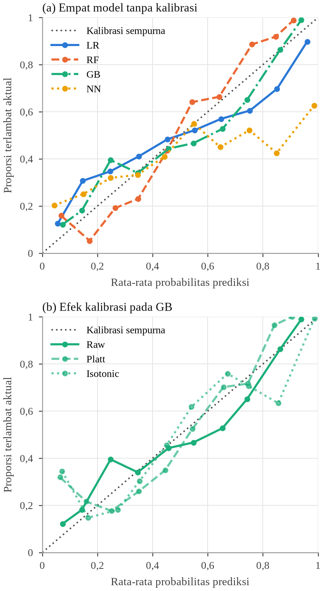
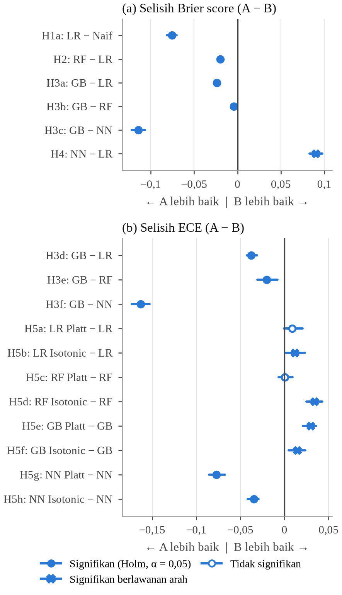
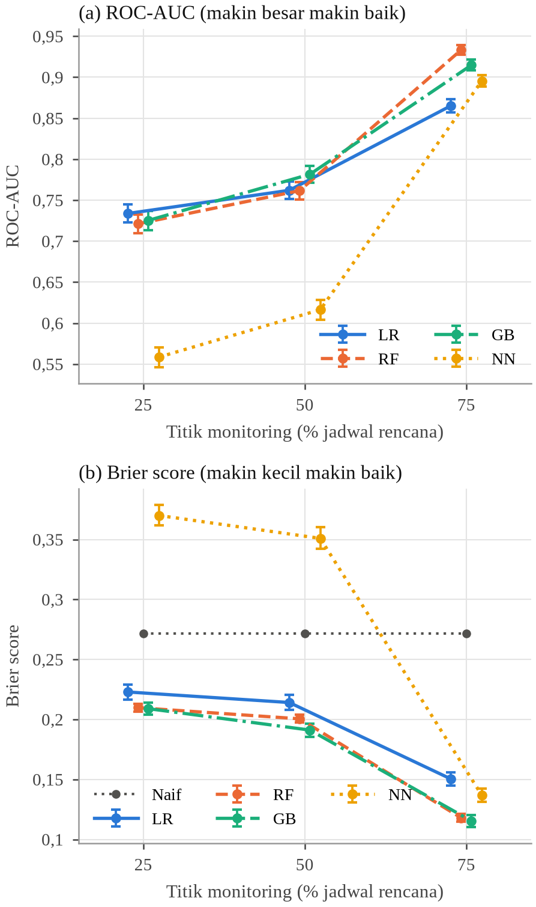
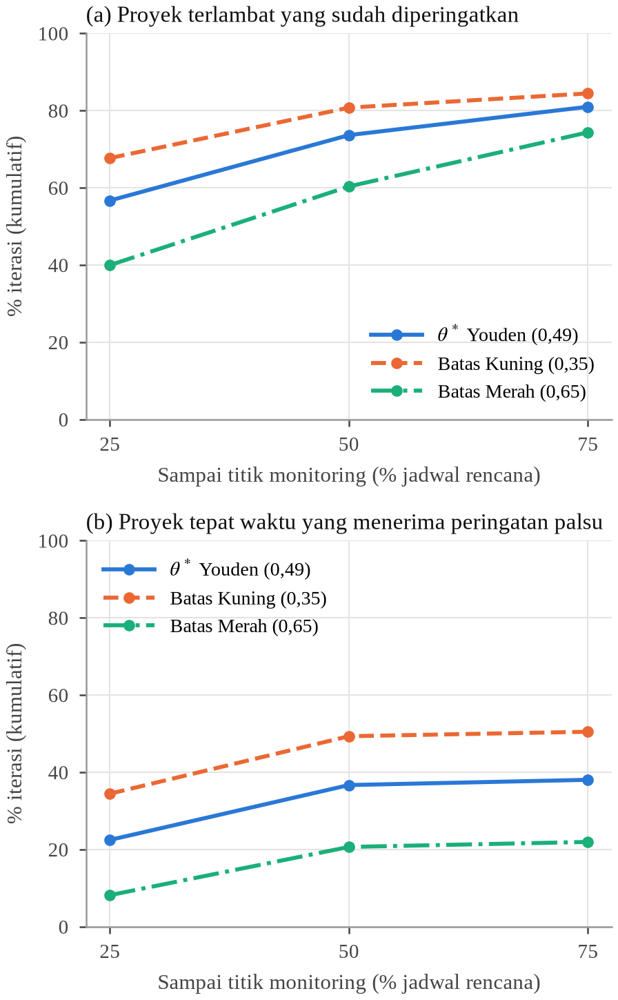

<!-- Naskah sumber. Sitasi ditulis sebagai [@kunci]; jalankan `python susun_paper.py` untuk menghasilkan
Paper_PRE02_Pustaka_Data.md (sitasi bernomor + Daftar Rujukan) dan .docx. Jangan sunting berkas hasil. -->

::: {custom-style="Penulis"}
Muktibaskara Kusbianto^1^, Muhammad Abdillah Kais Al Akmal^2^, Muhammad Ainul Yaqin^3^
:::

::: {custom-style="Afiliasi"}
Fakultas Sains dan Teknologi, Universitas Islam Negeri Maulana Malik Ibrahim Malang

^1^muktibaskrakusbianto@gmail.com, ^2^abdillahkais1@gmail.com, ^3^yaqinov@ti.uin-malang.ac.id
:::

**Abstract**

*Project managers need to know how likely a project is to be late, not only whether it is at risk. This study predicts the probability that a resource-constrained project finishes more than 5% beyond its baseline, using the eight subprojects of the Super ERP Farm Nation Enterprise portfolio. Because the projects have not been executed, historical data were generated by random-iteration simulation of the schedules, shared resources, change requests, and risk registers in the project management plans, giving 24,000 monitoring observations at 25%, 50%, and 75% of the planned schedule. Logistic Regression, Random Forest, Gradient Boosting, and a sigmoid-output neural network were evaluated with leave-one-subproject-out validation, with and without Platt and isotonic calibration. Gradient Boosting without additional calibration gave the most accurate and best-calibrated probabilities (Brier score 0.172, Brier skill score 0.367, ECE 0.056, ROC-AUC 0.815). The neural network was overconfident and performed worse than a naive baseline, and post-hoc calibration did not improve the tree-based models because calibration mappings did not transfer between projects. Discrimination rose from ROC-AUC 0.725 to 0.915 as projects progressed, and 56.7% of late projects were flagged at one quarter of the schedule. The schedule performance index was the dominant predictor.*

*Keywords: delay prediction, probability calibration, early warning system, resource-constrained projects, gradient boosting*

**Abstrak**

Manajer proyek membutuhkan informasi seberapa besar peluang proyek terlambat, bukan sekadar label berisiko atau tidak. Penelitian ini memprediksi probabilitas proyek dengan sumber daya terbatas selesai lebih dari 5% melewati *baseline* pada delapan subproyek portofolio Super ERP Farm Nation Enterprise. Karena proyek belum dilaksanakan, data historis dibangkitkan melalui simulasi iterasi random atas jadwal, sumber daya bersama, *change request*, dan register risiko pada dokumen *Project Management Plan*, menghasilkan 24.000 observasi *monitoring* pada titik 25%, 50%, dan 75% jadwal rencana. *Logistic Regression*, *Random Forest*, *Gradient Boosting*, dan *neural network* berkeluaran sigmoid dievaluasi dengan validasi *leave-one-subproject-out*, dengan dan tanpa kalibrasi Platt serta *isotonic regression*. *Gradient Boosting* tanpa kalibrasi tambahan menghasilkan probabilitas paling akurat dan paling terkalibrasi (*Brier score* 0,172; *Brier skill score* 0,367; ECE 0,056; ROC-AUC 0,815). *Neural network* terlalu yakin dan lebih buruk daripada pembanding naif, sedangkan kalibrasi pasca-latih tidak memperbaiki model berbasis pohon karena pemetaan kalibrasi tidak berpindah antarproyek. Daya beda model naik dari ROC-AUC 0,725 menjadi 0,915 seiring kemajuan proyek, dan 56,7% proyek yang akhirnya terlambat sudah diperingatkan pada seperempat jadwal. Indeks kinerja jadwal merupakan prediktor paling dominan.

Kata kunci: prediksi probabilitas, keterlambatan proyek, sumber daya terbatas, kalibrasi probabilitas, sistem peringatan dini

# 1. Pendahuluan

Keterlambatan merupakan masalah yang terus berulang pada proyek implementasi sistem enterprise. Proyek implementasi *Enterprise Resource Planning* (ERP) melibatkan jaringan interaksi pemangku kepentingan yang kompleks dari berbagai unit organisasi, dan pengelolaan yang tidak efektif sering menjadi penyebab kegagalan proyek [@ananta]. Pada portofolio yang terdiri atas beberapa subproyek, masalah ini diperberat oleh sumber daya kritis yang dipakai bersama, sehingga keterlambatan di satu aktivitas dapat menahan aktivitas lain yang menunggu sumber daya yang sama. Kinerja penjadwalan pada lingkungan multiproyek dengan sumber daya terbatas sangat bergantung pada kompleksitas jaringan aktivitas serta distribusi dan perebutan sumber daya [@browning]. Pengendalian proyek secara konvensional bertumpu pada *Earned Value Management* (EVM), yang meramalkan durasi akhir dari indikator kinerja jadwal secara deterministik [@batselier]. Pendekatan ini menghasilkan satu angka estimasi tanpa menyatakan seberapa yakin estimasi tersebut.

Pembelajaran mesin mulai dipakai untuk mengatasi keterbatasan tersebut. Metode kecerdasan buatan terbukti mengungguli metode EVM dalam meramalkan durasi proyek, dengan syarat data latih dan data uji memiliki karakter yang mirip [@wauters]. Pada proyek perangkat lunak, keterlambatan *issue* dapat diprediksi dari faktor risiko dengan ROC-AUC rata-rata 0,83 [@choetkiertikul], dan model Bayesian dinamis yang memakai dependensi dan beban kerja pengembang mampu memperbarui estimasi keterlambatan sepanjang proyek [@kula]. Pada proyek ERP berbasis *cloud*, *Random Forest* dengan fitur dari CPM dan PERT mencapai AUC 0,997 pada 100 data [@haekal]. Studi lain memprediksi keterlambatan sebagai kelas risiko kategorial [@gondia] atau memakai model *ensemble* untuk memprediksi risiko keterlambatan proyek perangkat lunak [@mandapatti] dan pesanan manufaktur [@impivaara].

Sebagian besar penelitian tersebut mengevaluasi model dengan metrik diskriminasi seperti akurasi, F1, atau ROC-AUC. Metrik ini mengukur kemampuan model membedakan proyek terlambat dan tepat waktu, tetapi tidak mengukur apakah angka probabilitasnya dapat dipercaya. Probabilitas 0,8 baru bermakna bila sekitar 80% proyek dengan nilai tersebut benar-benar terlambat, yaitu bila model terkalibrasi [@niculescu]. Kalibrasi tidak dapat diasumsikan: *boosted trees* dan SVM cenderung mendistorsi probabilitas [@niculescu], sedangkan jaringan saraf modern cenderung terlalu yakin [@guo]. Monitoring prediktif yang memberi sinyal penyimpangan saat proses berjalan telah diusulkan pada proses bisnis [@cabanillas]. Bila sinyal semacam itu berupa probabilitas yang dibandingkan dengan ambang, sistem peringatan dini hanya dapat diandalkan jika probabilitasnya terkalibrasi.

Celah penelitian yang dijawab artikel ini ada tiga. Pertama, prediksi keterlambatan pada portofolio multiproyek yang memodelkan keterbatasan sumber daya bersama dan dependensi aktivitas sekaligus masih jarang. Kedua, kalibrasi probabilitas keterlambatan belum dievaluasi secara sistematis, termasuk apakah kalibrasi yang dipelajari dari satu proyek berlaku untuk proyek lain. Ketiga, ketersediaan data historis menjadi kendala bagi proyek yang belum berjalan. Penggabungan simulasi dengan pembelajaran mesin telah terbukti meningkatkan akurasi analisis risiko jadwal [@fitzsimmons], dan pendekatan ini memungkinkan data historis dibangkitkan dari rencana proyek.

Penelitian ini bertujuan membangun dan membandingkan model yang memprediksi probabilitas keterlambatan proyek multi sumber daya terbatas dari kondisi aktual pada tahap *monitoring*, mengevaluasi kalibrasinya, dan menentukan ambang peringatan dini. Kebaruan penelitian ini terletak pada tiga hal: data historis dibangkitkan dari dokumen *Project Management Plan* (PMP) delapan subproyek nyata melalui simulasi yang setiap parameternya dirujuk ke dokumen, model diuji pada subproyek yang tidak pernah dilihatnya, dan kalibrasi probabilitas dievaluasi beserta kemampuannya berpindah antarproyek.

# 2. Metode Penelitian

## 2.1. Objek dan sumber data

Objek penelitian adalah portofolio Super ERP Farm Nation Enterprise 2026 yang terdiri atas delapan subproyek (P-FNE-01 sampai P-FNE-08) dengan sumber daya terbatas. Sumber data adalah dokumen PMP setiap subproyek. Dari dokumen tersebut diekstraksi 337 aktivitas beserta durasi dan dependensinya, alokasi sumber daya per peran, serta 171 risiko dari register risiko. Sebanyak 148 risiko disimulasikan; risiko perubahan lingkup tidak disimulasikan karena sudah diwakili oleh *change request* (CR), dan risiko biaya murni tidak disimulasikan karena tidak menggeser jadwal.

## 2.2. Pembangkitan data dengan simulasi iterasi random

Proyek belum dilaksanakan sehingga data realisasi belum tersedia. Data historis dibangkitkan dengan simulasi iterasi random yang menjalankan setiap subproyek 1.000 kali. Aktivitas dimulai satu hari setelah seluruh pendahulunya selesai dan hanya jika semua orang yang dibutuhkannya sedang tidak bekerja; aktivitas yang menunggu diantrekan dengan aturan *first come first served*. Jadwal tanpa gangguan menjadi *baseline* $T$.

Pada setiap iterasi, setiap aktivitas terkena CR dengan peluang 0,10. Kelas kesulitan CR rendah, sedang, dan tinggi (60%, 30%, 10%) menambah durasi aktivitas sebesar 10–20%, 30%, dan 50%. Setiap risiko $r$ terjadi dengan peluang $p_r$ dari register, yaitu skala 1–5 yang dikonversi menjadi 0,1; 0,3; 0,5; 0,7; 0,9 sesuai *Probability-Impact Matrix* PMP-01. Risiko yang terjadi menimpa satu aktivitas yang sedang berjalan pada hari acak dan menambah durasinya sebesar

$$\Delta d_i = d_i \times s(\ell_r) \times f $$

dengan $s(\ell_r)$ skala dampak jadwal PMP-01 untuk level dampak 1–5 (0,5%; 3%; 7,5%; 15%; 25%) dan $f$ faktor mitigasi. Nilai $f = 0{,}4$ dipilih karena menghasilkan median keterlambatan P-FNE-08 sebesar 5,3%, paling dekat dengan hasil analisis risiko kuantitatif dokumen PMP-08 (target 20 minggu, P50 21 minggu).

Setiap iterasi dipantau pada titik 25%, 50%, dan 75% dari $T$, sehingga diperoleh 8 × 1.000 × 3 = 24.000 observasi. Variabel bebas dihitung hanya dari kejadian sampai hari *monitoring* $t$, sehingga model tidak memakai informasi masa depan.

## 2.3. Variabel penelitian

Tabel 1 menyajikan tujuh variabel bebas dan variabel terikat. Ambang 5% mengikuti aturan pengendalian perubahan jadwal PMP-01, yaitu perubahan jadwal lebih dari 5% *baseline* harus disetujui sponsor proyek.

Tabel 1. Variabel penelitian

| Variabel | Definisi operasional |
| :--- | :--- |
| *X*~1~ SPI jadwal | EV(*t*)/PV(*t*) berbasis porsi durasi yang telah dikerjakan |
| *X*~2~ Sisa waktu | *T* − *t* (hari kerja) |
| *X*~3~ *Backlog* sisa | 1 − EV(*t*)/Σ*d*~*i*~ |
| *X*~4~ Utilisasi sumber daya | Hari-orang terpakai ÷ hari-orang tersedia sampai *t* |
| *X*~5~ Risiko belum dimitigasi | Jumlah risiko yang telah terjadi dan aktivitasnya belum selesai |
| *X*~6~ Frekuensi CR | Jumlah CR pada aktivitas yang sudah dimulai |
| *X*~7~ Pergeseran *dependency* | Rata-rata pergeseran hari siap aktivitas akibat pendahulunya |
| *Y* Status keterlambatan | 1 jika keterlambatan akhir > 5% dari *T* |

## 2.4. Model, validasi, dan kalibrasi

Empat model dibandingkan, yaitu *Logistic Regression* (LR, penalti L2, $C = 1$), *Random Forest* (RF, 100 pohon, kedalaman maksimum 3), *Gradient Boosting* (GB, 100 tahap, *learning rate* 0,05, kedalaman 2, *subsample* 0,8) [@friedman], dan *neural network* (NN) dua lapis tersembunyi 16 dan 8 neuron dengan keluaran sigmoid. Sebagai patokan dipakai pembanding naif yang selalu memprediksi proporsi terlambat pada data latih. *Hyperparameter* ditetapkan sebelum eksperimen, dan seluruh model dibangun dengan scikit-learn [@pedregosa].

Observasi dari subproyek yang sama sangat mirip, sehingga validasi dilakukan dengan *leave-one-subproject-out*: model dilatih pada tujuh subproyek dan diuji pada subproyek kedelapan, diulang delapan kali. Setiap observasi diprediksi tepat satu kali oleh model yang tidak pernah melihat subproyeknya. Setiap model diuji tanpa kalibrasi tambahan (Raw), dengan Platt scaling [@platt], dan dengan *isotonic regression* [@zadrozny]. Kalibrator dilatih dari lipatan dalam per subproyek di data latih. Model rekomendasi adalah kombinasi dengan *Brier score* terendah.

## 2.5. Metrik dan analisis

Akurasi probabilitas diukur dengan *Brier score* [@brier]

$$\mathrm{BS} = \frac{1}{N}\sum_{i=1}^{N}(p_i - y_i)^2 $$

dan *Brier skill score* $\mathrm{BSS} = 1 - \mathrm{BS}_{\text{model}}/\mathrm{BS}_{\text{naif}}$, dengan nilai positif berarti lebih baik daripada pembanding naif. Kalibrasi diukur dengan *expected calibration error* [@guo]

$$\mathrm{ECE} = \sum_{m=1}^{10}\frac{|B_m|}{N}\left|\bar{y}(B_m) - \bar{p}(B_m)\right| $$

serta *calibration intercept* dan *slope* yang idealnya 0 dan 1 [@vancalster]. *Brier score* juga diuraikan menjadi komponen *reliability* dan *resolution* [@murphy]. Daya beda diukur dengan ROC-AUC, dan ambang peringatan $\theta^*$ dipilih dengan statistik Youden [@youden]. Probabilitas dipetakan ke zona Hijau ($P < 0{,}35$), Kuning ($0{,}35 \le P < 0{,}65$), dan Merah ($P \ge 0{,}65$).

Hipotesis diturunkan dari tujuan setiap eksperimen. H1 menyatakan LR lebih akurat daripada pembanding naif dan terkalibrasi baik, H2 menyatakan RF lebih akurat daripada LR, H3 menyatakan GB memiliki *Brier score* dan ECE terkecil, H4 menyatakan NN lebih akurat daripada LR, dan H5 menyatakan kalibrasi Platt atau Isotonic menurunkan ECE. Ketidakpastian setiap metrik diukur dengan *bootstrap* persentil 2.000 replikasi yang mengambil ulang iterasi simulasi secara utuh [@efron]. Selisih antarmodel diuji berpasangan satu arah dengan koreksi Holm atas 17 uji [@holm], dan konsistensinya antarsubproyek diuji dengan uji peringkat bertanda Wilcoxon eksak pada delapan selisih per subproyek [@wilcoxon].

# 3. Hasil dan Pembahasan

## 3.1. Karakteristik data

Sebanyak 44,8% observasi berlabel terlambat, tetapi proporsinya sangat berbeda antarsubproyek (Tabel 2). P-FNE-02 hampir tidak pernah melewati ambang 5% karena *baseline*-nya panjang, sedangkan P-FNE-04 hampir selalu terlambat. P-FNE-08 memiliki *baseline* terpendek sehingga ambang 5%-nya hanya 3,1 hari.

Tabel 2. Karakteristik keterlambatan per subproyek (1.000 iterasi)

| Subproyek | *T* (hari) | Ambang 5% (hari) | Rata-rata keterlambatan (hari) | Terlambat > 5% |
| :--- | ---: | ---: | ---: | ---: |
| P-FNE-01 | 131 | 6,6 | 6,2 | 40,3% |
| P-FNE-02 | 232 | 11,6 | 5,9 | 0,4% |
| P-FNE-03 | 220 | 11,0 | 12,9 | 57,6% |
| P-FNE-04 | 120 | 6,0 | 18,6 | 98,9% |
| P-FNE-05 | 123 | 6,2 | 6,9 | 55,7% |
| P-FNE-06 | 120 | 6,0 | 5,9 | 38,1% |
| P-FNE-07 | 128 | 6,4 | 3,8 | 13,2% |
| P-FNE-08 | 62 | 3,1 | 3,4 | 54,0% |

## 3.2. Perbandingan model

Tabel 3 menunjukkan bahwa GB memiliki *Brier score*, ECE, dan *log loss* terkecil, sedangkan RF memiliki ROC-AUC tertinggi dengan selang kepercayaan yang tumpang tindih dengan GB. LR, RF, dan GB lebih akurat daripada pembanding naif, sedangkan NN memiliki BSS negatif.

Tabel 3. Kinerja model tanpa kalibrasi tambahan dengan selang kepercayaan 95% (N = 24.000)

| Model | *Brier score* | BSS | ECE | ROC-AUC |
| :--- | ---: | ---: | ---: | ---: |
| Pembanding naif | 0,2715 | 0 | 0,1546 | – |
| LR | 0,1958 [0,1904; 0,2008] | 0,279 | 0,0939 | 0,786 [0,778; 0,795] |
| RF | 0,1761 [0,1734; 0,1787] | 0,351 | 0,0762 | 0,818 [0,811; 0,825] |
| GB | 0,1718 [0,1672; 0,1762] | 0,367 | 0,0560 | 0,815 [0,806; 0,824] |
| NN | 0,2859 [0,2795; 0,2925] | −0,053 | 0,2188 | 0,696 [0,687; 0,704] |

Keunggulan model berbasis pohon atas LR menunjukkan bahwa hubungan kondisi proyek dengan keterlambatan tidak linear. Pengaruh SPI, misalnya, jauh lebih kuat di titik 75% (korelasi Spearman −0,786) daripada di titik 25% (−0,435), sehingga efeknya bergantung pada fase proyek. Pola RF dan *boosting* yang lebih unggul daripada LR juga dilaporkan pada prediksi kebutuhan perawatan armada [@grzelak]. GB tanpa kalibrasi tambahan menjadi yang paling terkalibrasi, berbeda dengan temuan bahwa *boosted trees* perlu dikalibrasi [@niculescu]. Perbedaan ini dapat dijelaskan dari fungsi kerugiannya: *boosting* yang dikaji pada studi tersebut tergolong pemaksimal *margin*, sedangkan GB di sini meminimalkan *log-loss* [@friedman] yang langsung menghukum probabilitas keliru. Prediksi GB berada pada rentang 0,036–0,973 tanpa satu pun nilai ekstrem. Sebaliknya, RF memiliki *calibration slope* 1,555, artinya probabilitasnya terlalu dekat ke tengah.

NN kalah dari pembanding naif karena terlalu yakin, sesuai temuan pada jaringan saraf modern [@guo]. Sebanyak 27,2% prediksi NN bernilai ≤ 0,01 atau ≥ 0,99, dan 31,6% di antaranya salah arah. Prediksi ekstrem yang salah ini saja menyumbang 1,005 dari total *log loss* NN sebesar 1,639. Hasil ini berbeda dengan studi yang menemukan MLP dan LR terbaik untuk keterlambatan produksi [@kannan], yang datanya berasal dari satu perusahaan, sedangkan di sini model diuji pada subproyek yang tidak pernah dilihatnya.

## 3.3. Kalibrasi probabilitas

Kalibrasi Platt dan Isotonic tidak memperbaiki LR, RF, maupun GB (Tabel 4); perbaikan hanya terjadi pada NN yang keluaran mentahnya paling buruk. *Brier score* GB juga memburuk dari 0,1718 menjadi 0,1860 dengan Platt dan 0,1880 dengan Isotonic. Gambar 1 memperlihatkan *reliability diagram* keempat model dan efek kalibrasi pada GB.

Tabel 4. ECE setiap kombinasi model dan kalibrasi

| Model | ECE Raw | ECE Platt | ECE Isotonic | Brier Raw |
| :--- | ---: | ---: | ---: | ---: |
| LR | 0,0939 | 0,1026 | 0,1058 | 0,1958 |
| RF | 0,0762 | 0,0765 | 0,1101 | 0,1761 |
| GB | 0,0560 | 0,0857 | 0,0701 | 0,1718 |
| NN | 0,2188 | 0,1417 | 0,1840 | 0,2859 |

Ada dua penjelasan yang saling melengkapi. Pertama, Platt scaling pada model yang sudah terkalibrasi justru mendorong probabilitas menjauhi 0 dan 1, dan *isotonic regression* mudah *overfit* bila data kalibrasi sedikit [@niculescu]. Kedua, kalibrasi tidak berpindah antarproyek. Platt yang dilatih dari prediksi tujuh subproyek lain menaikkan rata-rata ECE GB per subproyek dari 0,1615 menjadi 0,2046, sedangkan Platt yang dilatih pada subproyek itu sendiri menurunkannya menjadi 0,0271. Hal yang sama terlihat pada LR: di data latih *calibration slope*-nya sekitar 1,00, tetapi *calibration intercept* pada subproyek uji menyebar dari −2,777 (P-FNE-07) sampai 3,361 (P-FNE-04). Miskalibrasi berasal dari perbedaan tingkat keterlambatan dasar antarsubproyek, bukan dari model itu sendiri.

## 3.4. Pengujian hipotesis

Tabel 5 merangkum keputusan hipotesis dan Gambar 2 menyajikan selisih metrik setiap uji. H2 dan H3 diterima, H1 diterima sebagian karena *calibration intercept* LR 0,155 [0,089; 0,220] dan *slope* 0,586 [0,562; 0,610] tidak memuat nilai ideal, sedangkan H4 dan H5 ditolak. Selisih *Brier score* GB terhadap RF, sebagai kombinasi terbaik kedua, adalah −0,0043 [−0,0066; −0,0020].

Tabel 5. Keputusan hipotesis

| Hipotesis | Uji utama | Selisih [CI 95%] | Keputusan |
| :--- | :--- | ---: | :--- |
| H1 LR > naif, terkalibrasi | Brier LR − naif | −0,0757 [−0,0813; −0,0703] | Diterima sebagian |
| H2 RF > LR | Brier RF − LR | −0,0197 [−0,0232; −0,0163] | Diterima |
| H3 GB terbaik | Brier GB − RF | −0,0043 [−0,0066; −0,0020] | Diterima |
| | ECE GB − RF | −0,0202 [−0,0306; −0,0078] | |
| H4 NN > LR | Brier NN − LR | 0,0901 [0,0832; 0,0977] | Ditolak |
| H5 kalibrasi menurunkan ECE | ECE GB Platt − GB | 0,0297 [0,0210; 0,0358] | Ditolak |

Keunggulan antarmodel signifikan pada gabungan seluruh iterasi, tetapi tidak konsisten di setiap subproyek. Dari 17 uji, hanya keunggulan ECE GB atas NN yang signifikan pada uji Wilcoxon antarsubproyek ($p$ = 0,039); GB, misalnya, lebih akurat daripada RF hanya pada 5 dari 8 subproyek. Pola ini sejalan dengan temuan bahwa metode kecerdasan buatan hanya unggul bila data latih dan data uji mirip [@wauters]. Kasus paling jelas adalah P-FNE-08, dengan rata-rata prediksi GB 14,7% sedangkan proporsi terlambatnya 54,0% (BSS −0,414). Subproyek ini memiliki *baseline* terpendek dan utilisasi sumber daya terendah (0,048). Utilisasi berkorelasi positif dengan keterlambatan pada data gabungan (ρ = 0,289), tetapi tidak di dalam subproyek (median ρ = −0,054), sehingga model yang belajar bahwa utilisasi rendah berarti aman salah menilai P-FNE-08. Analisis tambahan dengan fitur yang dinormalisasi terhadap *baseline* hanya menggeser BSS P-FNE-08 menjadi −0,377, sehingga penyebabnya bukan skala fitur, melainkan kombinasi kondisi yang berada di luar rentang tujuh subproyek latih.

## 3.5. Waktu peringatan dan variabel berpengaruh

Ketepatan prediksi naik seiring kemajuan proyek (Gambar 3). ROC-AUC GB naik dari 0,725 pada titik 25% menjadi 0,782 pada titik 50% dan 0,915 pada titik 75%, sejalan dengan temuan bahwa prediksi keterlambatan makin akurat ketika informasi proyek bertambah [@kula]. Konsekuensinya, peringatan yang lebih dini memberi waktu bertindak lebih panjang tetapi lebih sering keliru (Tabel 6).

Tabel 6. Deteksi dini kumulatif dengan model GB

| Ambang | Terlambat diperingatkan s.d. 25% / 50% / 75% | Tidak pernah diperingatkan | Peringatan palsu s.d. 75% |
| :--- | ---: | ---: | ---: |
| 0,35 (batas Kuning) | 67,7% / 80,8% / 84,5% | 15,5% | 50,5% |
| 0,485 (*θ*^\*^ Youden) | 56,7% / 73,6% / 81,0% | 19,0% | 38,0% |
| 0,65 (batas Merah) | 40,0% / 60,4% / 74,4% | 25,6% | 22,0% |

Pada ambang $\theta^*$ = 0,485, *recall* keseluruhan 65,7% dan *specificity* 81,9%. Peringatan palsu umumnya terjadi pada proyek yang nyaris terlambat: proyek tepat waktu yang pernah diperingatkan memiliki median keterlambatan akhir 3,6% dari *baseline*, dibanding 2,8% pada yang tidak pernah diperingatkan. Zona bertingkat cocok dengan pola ini, karena zona Kuning menangkap lebih banyak proyek bermasalah untuk tindakan ringan, sedangkan zona Merah lebih jarang keliru sehingga layak dipakai untuk tindakan mahal seperti penambahan sumber daya. Sebagai ilustrasi, satu iterasi P-FNE-03 sudah berada di zona Merah sejak titik 25% (probabilitas 0,796) dan berakhir terlambat 11,7 hari, sehingga manajer proyek memiliki sekitar 165 hari kerja untuk melakukan tindakan korektif.

SPI merupakan satu-satunya variabel yang menaikkan *Brier score* GB pada kedelapan lipatan bila nilainya diacak (rata-rata kenaikan 0,0782), sejalan dengan peran sentral indikator kinerja jadwal dalam peramalan durasi [@batselier]. Pergeseran *dependency* tetap berkorelasi dengan keterlambatan di dalam subproyek (median ρ = 0,303), tetapi juga berkorelasi kuat dengan SPI (median ρ = −0,687), sehingga informasinya sudah terkandung dalam SPI. Frekuensi CR menunjukkan paradoks Simpson: korelasinya negatif pada data gabungan (ρ = −0,159) tetapi positif di dalam subproyek (median ρ = 0,324). Risiko belum dimitigasi hanya berhubungan dengan keterlambatan antarproyek (ρ = 0,278) dan hampir tidak di dalam proyek (median ρ = 0,016). Hasil ini tidak membantah pentingnya dependensi sebagai faktor keterlambatan yang dilaporkan penelitian lain [@kula; @sivakumar]; nilai prediktif tambahannya hilang setelah progres aktual teramati karena efeknya sudah tercermin dalam SPI.

## 3.6. Perbandingan dengan penelitian terdahulu

ROC-AUC penelitian ini lebih rendah daripada studi pada proyek ERP *cloud* dengan 100 data [@haekal] dan pada pesanan manufaktur satu perusahaan [@impivaara], tetapi sebanding dengan prediksi keterlambatan *issue* pada delapan proyek perangkat lunak [@choetkiertikul]. Perbandingan langsung tidak tepat karena domain, ukuran data, dan cara validasinya berbeda. Pengujian setiap subproyek dengan model yang tidak pernah melihatnya merupakan validasi yang lebih ketat dan lebih dekat dengan pemakaian pada proyek baru. *Brier score* juga bergantung pada sebaran label, sehingga penelitian ini melaporkan BSS terhadap pembanding naif untuk menilai akurasi probabilitas secara adil.

Penelitian ini memiliki beberapa keterbatasan. Data historis dibangkitkan dari rencana proyek sehingga hasil berlaku untuk proyek yang perilakunya sesuai asumsi simulasi. Jumlah subproyek hanya delapan, antrean sumber daya hanya memakai satu aturan prioritas padahal aturan prioritas berpengaruh pada kinerja penjadwalan multiproyek [@browning], dan perambatan keterlambatan antarsubproyek belum dimodelkan. Analisis sensitivitas menunjukkan BSS GB tetap positif pada faktor mitigasi 0,2 (0,383) dan 1,0 (0,258), tetapi ECE memburuk menjadi 0,114 saat dampak risiko lebih besar.

# 4. Kesimpulan

Penelitian ini menunjukkan bahwa probabilitas keterlambatan proyek multi sumber daya terbatas dapat diprediksi dari kondisi proyek pada tahap *monitoring*. *Gradient Boosting* tanpa kalibrasi tambahan menghasilkan probabilitas paling akurat dan paling terkalibrasi, dengan *Brier score* 0,1718, BSS 0,367 terhadap pembanding naif, ECE 0,0560, dan ROC-AUC 0,815. *Random Forest* lebih akurat daripada *Logistic Regression*, sedangkan *neural network* terlalu yakin dan lebih buruk daripada pembanding naif. Kalibrasi Platt dan *isotonic regression* tidak memperbaiki model berbasis pohon karena pemetaan kalibrasi yang dipelajari dari proyek lain tidak berlaku untuk proyek baru.

Probabilitas tersebut dapat dipakai sebagai dasar sistem peringatan dini berzona. Ketepatannya naik seiring kemajuan proyek, dari ROC-AUC 0,725 pada seperempat jadwal menjadi 0,915 pada tiga perempat jadwal, dan lebih dari separuh proyek yang akhirnya terlambat sudah diperingatkan pada seperempat jadwal. Peringatan pada tahap awal sebaiknya dipakai untuk memperketat pemantauan, sedangkan tindakan mahal sebaiknya didasarkan pada zona Merah atau konfirmasi pada pertengahan jadwal. Indeks kinerja jadwal merupakan variabel paling berpengaruh, sedangkan dependensi, frekuensi perubahan, dan risiko yang belum dimitigasi hampir tidak menambah informasi setelah progres aktual teramati.

Keunggulan model belum konsisten di setiap subproyek, terutama pada subproyek yang karakternya berbeda dari subproyek lain. Penelitian selanjutnya disarankan memvalidasi model dengan data realisasi proyek, mengkalibrasi ulang probabilitas secara bertahap dengan data awal proyek yang sedang berjalan, menambah jumlah proyek beserta variabel karakter proyek, serta memodelkan perambatan keterlambatan antarsubproyek.
